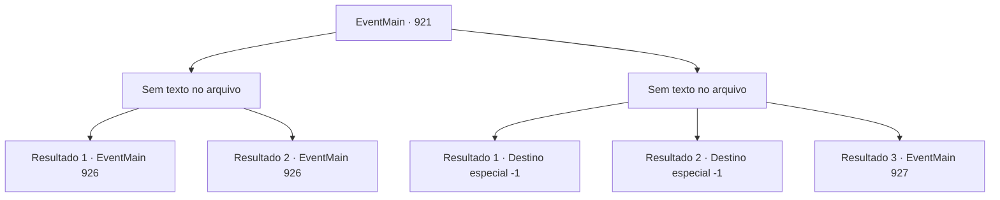

# Eventos principais · 921

[Índice da tabela](index.md) · [Índice geral](../index.md)

ID: `pt:EventMain:921` · Fonte: `EventMain4` · Versão: 1.2.47.

Mapeamento estático dos arquivos; a disponibilidade e a execução dependem do estado da run.

## Texto do evento

*Sem texto no arquivo.*

## Dados de entrada

```json
{
  "id": 921,
  "grade": 1,
  "normalGoal": "",
  "required": ""
}
```

## Mapa das escolhas



## Escolhas e resultados

### Escolha 1

*Sem texto no arquivo; o papel dessa opção depende da interface do jogo.*

Requisitos e outros campos da escolha:

```json
{
  "required": ""
}
```

#### Resultado 1.1

Rosilpha é jogada ao chão pelos ataques da Rainha. Mas você aproveita a oportunidade, desferindo o golpe final na Rainha. Ela se agarra a você em seus estertores de morte. 

 "Eu... Eu não vou morrer assim..!"

 Então seu rosto se divide em cruzes, tentáculos brancos se estendem dela. Mas você sacode a Rainha e esmaga sua cabeça no chão. Seu movimento para. 

 "Nós vencemos!"

 Rosilpha se curva ao chão, dominada pelo cansaço. Os guerreiros de Andaria compartilham a alegria da vitória rugindo de excitação ou se abraçando. <link=shake>

 "*coaxar * *coaxar * *coaxar *!!"

</link> O som de sapos ecoa pelo local. Deve ser assim que os gripplis celebram a vitória. Logo depois, uma serpente de videira se aproxima de você. A voz da Serpente Divina flui dela. 

 "Ambos desempenharam um papel enorme na proteção da selva. Diga, tenho uma oferta a fazer. Você estaria disposto a se tornar um campeão de Andaria?"

 Ao ouvir isso, Rosilpha pula de excitação. 

 "S- sério?!"

 Então o ancião cutuca suas costelas com o cotovelo. Quando o ancião lhe dá uma dica, Rosilpha suprime sua alegria e se ajoelha em sua perna. 

 "Caso me conceda tal posição, farei o meu melhor para cumprir meu dever."


Continuação registrada: [Evento 926](0926.md) na mesma tabela.

```json
{
  "required": "18_683_1",
  "chance": "1",
  "nextEvent": 926,
  "type": 2,
  "reward": ""
}
```

#### Resultado 1.2

Você trabalha junto com os guerreiros de Andaria, derrotando a Rainha. 

 "Eu... Eu não vou morrer assim..!"

 A Rainha tenta lutar, mas seu último recurso é recebido com uma enxurrada de espadas e lanças. 

 "...NÓS VENCEMOS!"

 Rosilpha se curva ao chão, dominado pelo cansaço. Os guerreiros de Andaria compartilham a alegria da vitória rugindo de excitação ou se abraçando. <link=shake>

 "*coaxar * *coaxar * *coaxar *!!"

</link> O som de sapos ecoa pelo local. Deve ser assim que os gripplis celebram a vitória. Logo depois, uma serpente de videira se aproxima de você. A voz da Serpente Divina flui dela. 

 "Ambos desempenharam um papel importante na proteção da selva. Diga, tenho uma oferta a fazer. Você estaria disposto a se tornar um campeão de Andaria?"

 Ouvindo isso, Rosilpha pula de excitação. 

 "S- sério?!"

 Então o ancião cutuca suas costelas com o cotovelo. Quando o ancião dá uma dica, Rosilpha suprime sua alegria e se ajoelha em sua perna. 

 "Caso você me conceda tal posição, farei o meu melhor para cumprir meu dever."


Continuação registrada: [Evento 926](0926.md) na mesma tabela.

```json
{
  "required": "5_683_1",
  "chance": "1",
  "nextEvent": 926,
  "type": 2,
  "reward": ""
}
```

### Escolha 2

*Sem texto no arquivo; o papel dessa opção depende da interface do jogo.*

Requisitos e outros campos da escolha:

```json
{
  "required": ""
}
```

#### Resultado 2.1

Você é derrubado pelo ataque da Rainha. Você não tem certeza exata de onde, mas alguns de seus ossos devem ter quebrado, julgando pela dor extrema que está sentindo. Antes mesmo de poder se levantar, os tentáculos afiados da Rainha se esticam. Mas eles não te alcançam. É porque Rosilpha os bloqueou com seu corpo. 

 "Aargh... dói..."

 Rosilpha agarra o tentáculo que perfurou seu estômago com suas mãos ensanguentadas. Então ele puxa a corda do arco, usando Mão do Mago. 

 "Flecha magia de Rosilpha..!"

 Ele faz seu último disparo, nomeado em sua homenagem. Mas a Rainha simplesmente o reflete com suas mãos. 

 "Este é o seu mel... huh?"

 A voz confiante da Rainha para de repente. Há uma flecha presa entre os olhos da Rainha. A flecha que ela bloqueou era falsa, e a verdadeira estava imbuida com invisibilidade magia. <link=shake>

 "Aargh..aaAAARRGH!!!"

</link> A Rainha grita dolorosamente, torcendo seu corpo. E então, como tinta preta se espalhando em água clara, o corpo da Rainha se torna negro e desmorona. Rosilpha explode em uma pequena risada olhando para isso. Você tenta ajudá-lo a se levantar, mas ele balança a cabeça em vez disso. 

 "Este... é o meu fim, {1}... Mas... Mas não tenho arrependimentos. Eu... até o fim... como o grippli que sou..."

 Essas são as últimas palavras de Rosilpha, após as quais ele deixa cair seu arco. Somente então os guerreiros de Andaria são libertados do domínio da Rainha, capazes de se mover novamente. Eles se reúnem perto de você e Rosilpha.

Continuação registrada: [Destino especial `-1`](../destinos-especiais.md).

```json
{
  "required": "18_683_1",
  "chance": "1",
  "nextEvent": -1,
  "type": 2,
  "reward": "15_6_5|15_6_9|15_6_12"
}
```

#### Resultado 2.2

Você é derrubado pelo ataque da Rainha. Você não tem certeza exata de onde, mas alguns de seus ossos devem ter quebrado, julgando pela dor extrema que está sentindo. Antes mesmo de poder se levantar, os tentáculos afiados da Rainha se esticam. 

 "N- NÃO!"

 Rosilpha puxa apressadamente a corda de seu arco, mas é tarde demais. Os tentáculos impiedosamente cortam sua cabeça do seu corpo.

Continuação registrada: [Destino especial `-1`](../destinos-especiais.md).

```json
{
  "required": "18_683_1",
  "chance": "3",
  "nextEvent": -1,
  "type": 2,
  "reward": "15_6_1|15_6_9|25_8_1"
}
```

#### Resultado 2.3

Você é derrubado pelo ataque da Rainha. Você não tem certeza exata de onde, mas alguns de seus ossos devem ter quebrado, julgando pela dor extrema que está sentindo. Antes mesmo de poder se levantar, os tentáculos afiados da Rainha se esticam. Mas eles não alcançam você. Guerreiros orcs bloqueiam os tentáculos, enquanto os goblins atrapalham a visão da Rainha. Então, do nada, uma videira de árvore consciente agarra os tentáculos. A serpente de videira da árvore, a pantera das sombras e o sasquatch amarelo se recuperaram enquanto você estava lutando. Eles voltaram para a luta. Vendo que a Rainha está em desvantagem numérica, você finalmente se sente seguro. Este é o momento em que você perde a consciência.

Continuação registrada: [Evento 927](0927.md) na mesma tabela.

```json
{
  "required": "5_683_1",
  "chance": "1",
  "nextEvent": 927,
  "type": 2,
  "reward": ""
}
```

## Referências que chegam a este evento

- [Evento 920 · escolha 1 · resultado 1](0920.md#escolha-1)
- [Evento 920 · escolha 1 · resultado 2](0920.md#escolha-1)
- [Evento 920 · escolha 2 · resultado 1](0920.md#escolha-2)
- [Evento 920 · escolha 2 · resultado 2](0920.md#escolha-2)
