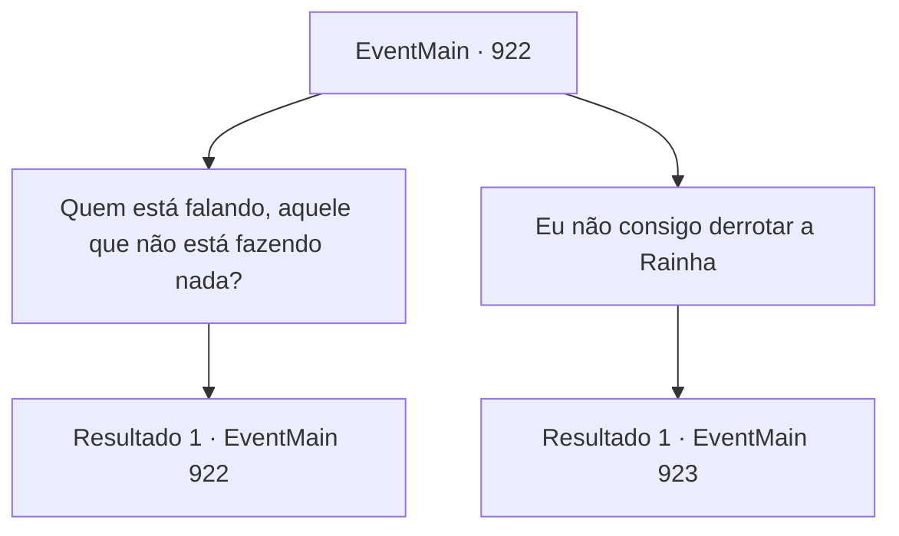

# Eventos principais · 922

[Índice da tabela](index.md) · [Índice geral](../index.md)

ID: `pt:EventMain:922` · Fonte: `EventMain4` · Versão: 1.2.47.

Mapeamento estático dos arquivos; a disponibilidade e a execução dependem do estado da run.

## Texto do evento

*Sem texto no arquivo.*

## Dados de entrada

```json
{
  "id": 922,
  "grade": 1,
  "normalGoal": "",
  "required": ""
}
```

## Mapa das escolhas



## Escolhas e resultados

### Escolha 1

Quem está falando, aquele que não está fazendo nada?

Requisitos e outros campos da escolha:

```json
{
  "required": "5_684_0"
}
```

#### Resultado 1.1

Você grita com a Serpente Divina. Então, ela responde. 

 "Meus campeões fecharam o portal, e no processo eles foram gravemente feridos. Estou curando eles."


Continuação registrada: [Evento 922](0922.md) na mesma tabela.

```json
{
  "required": "",
  "chance": "1",
  "nextEvent": 922,
  "type": 2,
  "reward": "5_684_1"
}
```

### Escolha 2

Eu não consigo derrotar a Rainha

Requisitos e outros campos da escolha:

```json
{
  "required": ""
}
```

#### Resultado 2.1

Você diz que está exausto, incapaz de levantar um dedo sequer. Em resposta ao seu pedido de que não pode lutar contra a Rainha, ele diz o seguinte. 

 "Tudo que você precisa fazer é segurar a linha até que meus campeões estejam curados. Isso será o suficiente."


Continuação registrada: [Evento 923](0923.md) na mesma tabela.

```json
{
  "required": "",
  "chance": "1",
  "nextEvent": 923,
  "type": 2,
  "reward": ""
}
```

## Referências que chegam a este evento

- [Evento 918 · escolha 2 · resultado 1](0918.md#escolha-2)
- [Evento 919 · escolha 2 · resultado 1](0919.md#escolha-2)
- [Evento 922 · escolha 1 · resultado 1](0922.md#escolha-1)
