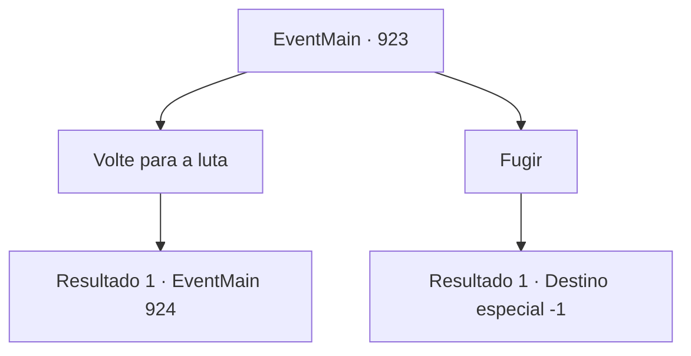

# Eventos principais · 923

[Índice da tabela](index.md) · [Índice geral](../index.md)

ID: `pt:EventMain:923` · Fonte: `EventMain4` · Versão: 1.2.47.

Mapeamento estático dos arquivos; a disponibilidade e a execução dependem do estado da run.

## Texto do evento

*Sem texto no arquivo.*

## Dados de entrada

```json
{
  "id": 923,
  "grade": 1,
  "normalGoal": "",
  "required": ""
}
```

## Mapa das escolhas



## Escolhas e resultados

### Escolha 1

Volte para a luta

Requisitos e outros campos da escolha:

```json
{
  "required": ""
}
```

#### Resultado 1.1

Você responde que voltará para a luta contra a Rainha. Então, os olhos do totem começam a brilhar, curando seus ferimentos. Revigorado, você faz o caminho de volta para o Olho Azul. Logo, você chega ao lago, mas Rosilpha não está em lugar algum. Pedacos de carne e o arco de Rosilpha cobrem o chão. Os guerreiros de Andaria estão correndo apressadamente, largando suas armas. A Rainha, ensopada de sangue, lentamente se aproxima de você, seus olhos brilhando de vermelho. Então, esticando suas mãos ensanguentadas, ela dispara raios de relâmpagos carmesim.

Continuação registrada: [Evento 924](0924.md) na mesma tabela.

```json
{
  "required": "",
  "chance": "1",
  "nextEvent": 924,
  "type": 2,
  "reward": "0_0_1|0_1_1|6_0_171|5_680_2",
  "place": 1
}
```

### Escolha 2

Fugir

Requisitos e outros campos da escolha:

```json
{
  "required": ""
}
```

#### Resultado 2.1

Você diz que vai fugir. A Serpente Divina responde, abrindo um caminho na selva. 

 "Vá, então. Mas avise os humanos do perigo. Prepare-se para uma guerra. Diga a eles para procurarem essas criaturas desumanas, vestindo as carcaças de pessoas."

 Você foge, longe da Selva de Andaria.

Continuação registrada: [Destino especial `-1`](../destinos-especiais.md).

```json
{
  "required": "",
  "chance": "1",
  "nextEvent": -1,
  "type": 2,
  "reward": "15_6_23"
}
```

## Referências que chegam a este evento

- [Evento 922 · escolha 2 · resultado 1](0922.md#escolha-2)
