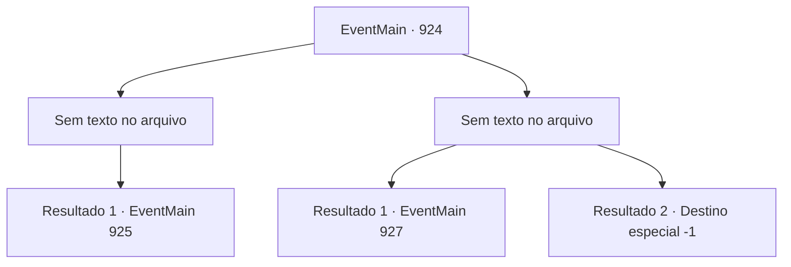

# Eventos principais · 924

[Índice da tabela](index.md) · [Índice geral](../index.md)

ID: `pt:EventMain:924` · Fonte: `EventMain4` · Versão: 1.2.47.

Mapeamento estático dos arquivos; a disponibilidade e a execução dependem do estado da run.

## Texto do evento

*Sem texto no arquivo.*

## Dados de entrada

```json
{
  "id": 924,
  "grade": 1,
  "normalGoal": "",
  "required": ""
}
```

## Mapa das escolhas



## Escolhas e resultados

### Escolha 1

*Sem texto no arquivo; o papel dessa opção depende da interface do jogo.*

Requisitos e outros campos da escolha:

```json
{
  "required": ""
}
```

#### Resultado 1.1

Você derrota a Rainha dos devoradores de almas. No entanto, ela se recusa a admitir a derrota, se agarrando a você em seus últimos suspiros. 

 "Eu... Eu não vou morrer assim..!"

 Então seu rosto se divide em cruzes, tentáculos brancos se estendem dela. Mas você sacode a Rainha e esmaga sua cabeça no chão. Seus movimentos param. Os guerreiros de Andaria se reúnem perto de você para confirmar a morte da Rainha. O ancião grippli se aproxima de você, abrindo caminho pela multidão. 

 "...Quanto ao nosso bravo herói grippli, eu mesmo o enterrarei. Você fez bem."

 Ele esconde suas lágrimas, voltando para uma das plantas aquáticas. A serpente de videira da árvore, com seus ferimentos recuperados, se aproxima de você. A voz da Serpente Divina flui dela. 

 "Você desempenhou um papel enorme na proteção da selva. Diga, tenho uma oferta a fazer. Você estaria disposto a se tornar um campeão de Andaria?"


Continuação registrada: [Evento 925](0925.md) na mesma tabela.

```json
{
  "required": "",
  "chance": "1",
  "nextEvent": 925,
  "type": 2,
  "reward": ""
}
```

### Escolha 2

*Sem texto no arquivo; o papel dessa opção depende da interface do jogo.*

Requisitos e outros campos da escolha:

```json
{
  "required": ""
}
```

#### Resultado 2.1

Você é derrubado pelo ataque da Rainha. Você não tem certeza exata de onde, mas alguns de seus ossos devem ter quebrado, julgando pela dor extrema que está sentindo. Antes mesmo de poder se levantar, os tentáculos afiados da Rainha se esticam. Mas eles não alcançam você. Do nada, uma videira de árvore consciente agarra os tentáculos. A serpente de videira da árvore, a pantera das sombras e o sasquatch amarelo se recuperaram enquanto você estava lutando. Eles voltaram para a luta. Impotente, você perde a consciência.

Continuação registrada: [Evento 927](0927.md) na mesma tabela.

```json
{
  "required": "1_0_2|1_1_2",
  "chance": "1",
  "nextEvent": 927,
  "type": 2,
  "reward": "0_0_-1|0_1_-1"
}
```

#### Resultado 2.2

Você é derrubado pelo ataque da Rainha. Você não tem certeza exata de onde, mas alguns de seus ossos devem ter quebrado, julgando pela dor extrema que está sentindo. Antes mesmo de conseguir se levantar, os tentáculos afiados da Rainha se esticam. Os tentáculos destroem seu corpo em pedaços.

Continuação registrada: [Destino especial `-1`](../destinos-especiais.md).

```json
{
  "required": "-1|2_0_2|2_1_2",
  "chance": "1",
  "nextEvent": -1,
  "type": 2,
  "reward": "0_0_-1|0_1_-1|15_6_1|15_6_9|25_8_1"
}
```

## Referências que chegam a este evento

- [Evento 919 · escolha 1 · resultado 2](0919.md#escolha-1)
- [Evento 923 · escolha 1 · resultado 1](0923.md#escolha-1)
