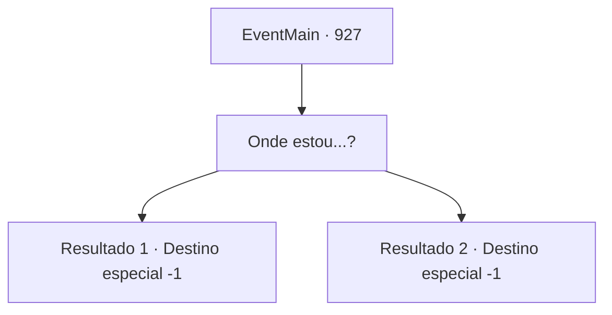

# Eventos principais · 927

[Índice da tabela](index.md) · [Índice geral](../index.md)

ID: `pt:EventMain:927` · Fonte: `EventMain4` · Versão: 1.2.47.

Mapeamento estático dos arquivos; a disponibilidade e a execução dependem do estado da run.

## Texto do evento

*Sem texto no arquivo.*

## Dados de entrada

```json
{
  "id": 927,
  "grade": 1,
  "normalGoal": "",
  "required": ""
}
```

## Mapa das escolhas



## Escolhas e resultados

### Escolha 1

Onde estou...?

Requisitos e outros campos da escolha:

```json
{
  "required": ""
}
```

#### Resultado 1.1

Você acorda sob um teto desconhecido. O quarto tem um leve cheiro de chá. Ao seu lado está Rosilpha. 

 "Você está acordado...! Graças aos Deuses...!"

 Rosilpha vai chamar o ancião, que segura suas mãos com dedos escorregadios. Ele engole suas lágrimas, falando. 

 "Obrigado. Você fez tão, tão bem."

 O ancião conta tudo o que aconteceu. Enquanto você lutava contra a Rainha, os campeões da Serpente Divina se recuperaram e, por fim, derrubaram a Rainha dos devoradores de almas. 

 "A Serpente Divina disse que quer falar com você. Venha, agora."

 Você segue o ancião até o totem da Serpente Divina. Assim que o ancião termina suas orações, os olhos do totem começam a brilhar. 

 "Ótimo trabalho. Você desempenhou um papel enorme na batalha. Eu te agradeço."

 Então, uma aura mística flui do totem para você. Você sente uma vibração agradável. 

 "Você será capaz de superar qualquer dificuldade, não importa quão grave a situação possa parecer. Eu te agradeço novamente."


Continuação registrada: [Destino especial `-1`](../destinos-especiais.md).

```json
{
  "required": "18_680_2",
  "chance": "1",
  "nextEvent": -1,
  "type": 2,
  "reward": "15_6_5|15_6_7|15_6_12"
}
```

#### Resultado 1.2

Você acorda sob um teto desconhecido. O quarto tem um leve cheiro de chá. Ao seu lado está o ancião grippli. 

 "Você está acordado...! Graças aos Deuses...!"

 Ele segura suas mãos com seus dedos escorregadios. Ele engole suas lágrimas, falando. 

 "Obrigado. Eu... Eu não posso te agradecer o suficiente. Obrigado. Você nos ajudou a proteger nossa casa, nosso povo."

 O ancião conta tudo o que aconteceu. Enquanto você lutava contra a Rainha, os campeões da Serpente Divina se recuperaram e, finalmente, derrubaram a Rainha dos devoradores de almas. 

 "A Serpente Divina disse que queria falar com você. Venha, agora."

 Você segue o ancião até o totem da Serpente Divina. Assim que o ancião termina suas orações, os olhos do totem começam a brilhar. 

 "Ótimo trabalho. Você desempenhou um papel enorme na batalha. Eu te agradeço."

 Então, uma aura mística flui do totem para você. Você sente uma vibração agradável. 

 "Você será capaz de superar qualquer dificuldade, não importa quão grave a situação possa parecer. Eu te agradeço novamente."


Continuação registrada: [Destino especial `-1`](../destinos-especiais.md).

```json
{
  "required": "5_680_2",
  "chance": "1",
  "nextEvent": -1,
  "type": 2,
  "reward": "15_6_5|15_6_9|15_6_12"
}
```

## Referências que chegam a este evento

- [Evento 921 · escolha 2 · resultado 3](0921.md#escolha-2)
- [Evento 924 · escolha 2 · resultado 1](0924.md#escolha-2)
