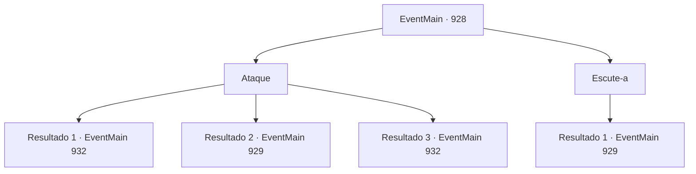

# Eventos principais · 928

[Índice da tabela](index.md) · [Índice geral](../index.md)

ID: `pt:EventMain:928` · Fonte: `EventMain4` · Versão: 1.2.47.

Mapeamento estático dos arquivos; a disponibilidade e a execução dependem do estado da run.

## Texto do evento

Você se depara com uma mulher impressionante que chama sua atenção. |drawing_outerQueen| Ela tem uma pele macia e branca, uma figura escultural e cabelos sedosos e longos. Você faz contato visual com ela e sente como se seus olhos dourados estivessem te atraindo. 

 "... Podemos conversar?"


## Dados de entrada

```json
{
  "id": 928,
  "grade": 1,
  "normalGoal": "",
  "required": "13_5_6|1_2_90"
}
```

## Mapa das escolhas



## Escolhas e resultados

### Escolha 1

Ataque

Requisitos e outros campos da escolha:

```json
{
  "required": ""
}
```

#### Resultado 1.1

Você tenta atacar a mulher suspeita. No entanto, devoradores de almas escondidos surgem atrás dela das árvores e arbustos. Eles te atacam imediatamente.

Continuação registrada: [Evento 932](0932.md) na mesma tabela.

```json
{
  "required": "24_7_1",
  "chance": "1|0_12_1",
  "nextEvent": 932,
  "type": 0,
  "reward": "6_3_169",
  "place": 1
}
```

#### Resultado 1.2

O olhar da mulher se fixa em você. Você não consegue atacá-la. Ela olha para você com seus olhos dourados, e diz com uma voz gentil e terna. 

 "Eu sou a Rainha de Nepe-Akalish. Não temos intenção de lutar contra você. Pelo contrário - nós... estamos aqui para te salvar."

 Você pergunta o que ela quer dizer com isso. A Rainha responde com um leve sorriso. 

 "Seus Deuses criaram um sistema para explorá-los - o sistema que vocês humanos chamam de reencarnação. Presos em um ciclo interminável de nascimento e morte, vocês dedicam sua fé e almas a eles. E essas chamadas divindades sobrevivem com suas homenagens sem sentido."

 Ela continua com a voz elevada. 

 "Pense nisso. Como os deuses são egoístas. Como são imprudentes. Sem vocês, eles não são nada - e ainda assim tratam vocês como se fossem gado! O que pretendemos fazer... é quebrar esse ciclo de exploração."

 A mulher estende as mãos para você. 

 "Venha. Junte-se a nós."


Continuação registrada: [Evento 929](0929.md) na mesma tabela.

```json
{
  "required": "24_7_1",
  "chance": "20",
  "nextEvent": 929,
  "type": 1,
  "reward": ""
}
```

#### Resultado 1.3

Você tenta atacar a mulher suspeita. No entanto, devoradores de almas escondidos surgem atrás dela das árvores e arbustos. Eles te atacam imediatamente.

Continuação registrada: [Evento 932](0932.md) na mesma tabela.

```json
{
  "required": "23_7_1",
  "chance": "1",
  "nextEvent": 932,
  "type": 2,
  "reward": "6_3_169",
  "place": 1
}
```

### Escolha 2

Escute-a

Requisitos e outros campos da escolha:

```json
{
  "required": ""
}
```

#### Resultado 2.1

Você decide ouvir a mulher. Ela olha para você com seus olhos dourados e diz com uma voz gentil e terna. 

 "Nós somos Nepe-Akalish. Não temos intenção de lutar contra você. Pelo contrário - nós... estamos aqui para te salvar."

 Você pergunta o que ela quer dizer com isso. A Rainha responde com um leve sorriso. 

 "Seus Deuses criaram um sistema para explorá-los - o sistema que vocês humanos chamam de reencarnação. Presos em um ciclo interminável de nascimento e morte, vocês dedicam sua fé e almas a eles. E essas chamadas divindades sobrevivem com suas homenagens sem sentido."

 Ela continua com uma voz elevada. 

 "Pense nisso. Como os deuses são egoístas. Como são imprudentes. Sem vocês, eles não são nada - e ainda assim tratam vocês como se fossem gado! O que pretendemos fazer... é quebrar esse ciclo de exploração."

 A mulher estende as mãos para você. 

 "Venha. Junte-se a nós."


Continuação registrada: [Evento 929](0929.md) na mesma tabela.

```json
{
  "required": "",
  "chance": "1",
  "nextEvent": 929,
  "type": 2,
  "reward": ""
}
```

## Referências que chegam a este evento

Nenhum `nextEvent` positivo da mesma tabela aponta para este nó. Isso não prova que seja inacessível: sorteio e estado de história podem selecioná-lo.

