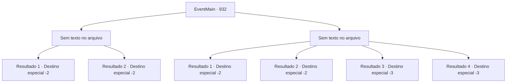

# Eventos principais · 932

[Índice da tabela](index.md) · [Índice geral](../index.md)

ID: `pt:EventMain:932` · Fonte: `EventMain4` · Versão: 1.2.47.

Mapeamento estático dos arquivos; a disponibilidade e a execução dependem do estado da run.

## Texto do evento

*Sem texto no arquivo.*

## Dados de entrada

```json
{
  "id": 932,
  "grade": 1,
  "normalGoal": "",
  "required": ""
}
```

## Mapa das escolhas



## Escolhas e resultados

### Escolha 1

*Sem texto no arquivo; o papel dessa opção depende da interface do jogo.*

Requisitos e outros campos da escolha:

```json
{
  "required": ""
}
```

#### Resultado 1.1

Cada vez mais devoradores de almas estão chegando. Depois de lidar com alguns guerreiros devoradores de almas, você foge na direção de Brikkalua. Alguns vêm atrás de você, mas você consegue escapar.

Continuação registrada: [Destino especial `-2`](../destinos-especiais.md).

```json
{
  "required": "13_5_6",
  "chance": "1",
  "nextEvent": -2,
  "type": 2,
  "reward": "13_5_62"
}
```

#### Resultado 1.2

Cada vez mais devoradores de almas estão chegando. Depois de lidar com alguns guerreiros devoradores de almas, você foge na direção de Brikkalua. Alguns vêm atrás de você, mas você consegue escapar.

Continuação registrada: [Destino especial `-2`](../destinos-especiais.md).

```json
{
  "required": "13_5_7",
  "chance": "1",
  "nextEvent": -2,
  "type": 2,
  "reward": "13_5_72"
}
```

### Escolha 2

*Sem texto no arquivo; o papel dessa opção depende da interface do jogo.*

Requisitos e outros campos da escolha:

```json
{
  "required": ""
}
```

#### Resultado 2.1

Cada vez mais devoradores de almas estão chegando. Você decide sair correndo antes de ser cercado. Alguns vêm atrás de você, mas você consegue escapar.

Continuação registrada: [Destino especial `-2`](../destinos-especiais.md).

```json
{
  "required": "1_0_2|1_1_2|13_5_6",
  "chance": "1",
  "nextEvent": -2,
  "type": 2,
  "reward": "0_0_-1|0_1_-1|13_5_62"
}
```

#### Resultado 2.2

Cada vez mais devoradores de almas estão chegando. Você decide sair correndo antes de ser cercado. Alguns vêm atrás de você, mas você consegue escapar.

Continuação registrada: [Destino especial `-2`](../destinos-especiais.md).

```json
{
  "required": "1_0_2|1_1_2|13_5_7",
  "chance": "1",
  "nextEvent": -2,
  "type": 2,
  "reward": "0_0_-1|0_1_-1|13_5_72"
}
```

#### Resultado 2.3

Você é derrotado pelos devoradores de almas. Seus tentáculos te agarram, quebrando seus ossos em um instante.

Continuação registrada: [Destino especial `-3`](../destinos-especiais.md).

```json
{
  "required": "2_0_2",
  "chance": "1",
  "nextEvent": -3,
  "type": 2,
  "reward": "0_0_-1|0_1_-1"
}
```

#### Resultado 2.4

Você é derrotado pelos devoradores de almas. Seus tentáculos te agarram, quebrando seus ossos em um instante.

Continuação registrada: [Destino especial `-3`](../destinos-especiais.md).

```json
{
  "required": "2_1_2",
  "chance": "1",
  "nextEvent": -3,
  "type": 2,
  "reward": "0_0_-1|0_1_-1"
}
```

## Referências que chegam a este evento

- [Evento 928 · escolha 1 · resultado 1](0928.md#escolha-1)
- [Evento 928 · escolha 1 · resultado 3](0928.md#escolha-1)
- [Evento 929 · escolha 2 · resultado 1](0929.md#escolha-2)
- [Evento 929 · escolha 2 · resultado 3](0929.md#escolha-2)
- [Evento 930 · escolha 1 · resultado 1](0930.md#escolha-1)
- [Evento 930 · escolha 1 · resultado 3](0930.md#escolha-1)
- [Evento 931 · escolha 2 · resultado 1](0931.md#escolha-2)
- [Evento 931 · escolha 2 · resultado 3](0931.md#escolha-2)
