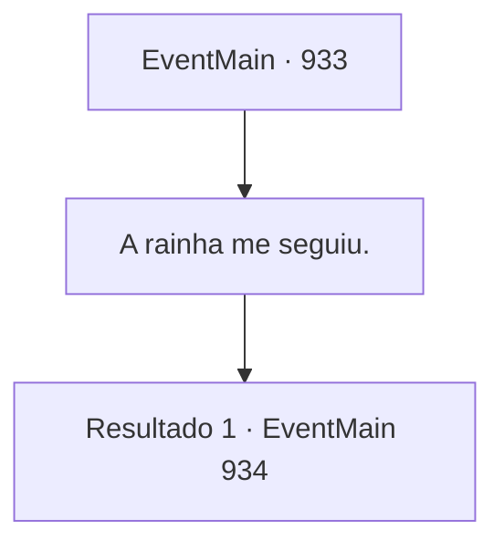

# Eventos principais · 933

[Índice da tabela](index.md) · [Índice geral](../index.md)

ID: `pt:EventMain:933` · Fonte: `EventMain4` · Versão: 1.2.47.

Mapeamento estático dos arquivos; a disponibilidade e a execução dependem do estado da run.

## Texto do evento

Você chega ao Patito Flotante na Selva de Andaria. Lá você encontra Naverr e Rosilpha, que já chegaram. Naverr te saúda alegremente. 

 "Bem-vindo. Você não encontrou devoralmas no caminho, certo? Estranho. Nenhum veio atrás de nós."


## Dados de entrada

```json
{
  "id": 933,
  "grade": 1,
  "normalGoal": "",
  "required": "13_5_72|1_2_100"
}
```

## Mapa das escolhas



## Escolhas e resultados

### Escolha 1

A rainha me seguiu.

Requisitos e outros campos da escolha:

```json
{
  "required": ""
}
```

#### Resultado 1.1

Você se lembra que já encontrou a Rainha dos devoradores de almas antes. Naverr inclina a cabeça, então fala. 

 "Hmm... Eles devem estar rastreando os artefatos ou algo assim. Não tenho certeza de como, mas isso significa que eles estarão aqui em breve."

 Rosilpha acrescenta, concordando com ele. 

 "Vou contar isso ao ancião. Precisamos destruir esses artefatos."


Continuação registrada: [Evento 934](0934.md) na mesma tabela.

```json
{
  "required": "",
  "chance": "1",
  "nextEvent": 934,
  "type": 2,
  "reward": ""
}
```

## Referências que chegam a este evento

Nenhum `nextEvent` positivo da mesma tabela aponta para este nó. Isso não prova que seja inacessível: sorteio e estado de história podem selecioná-lo.

