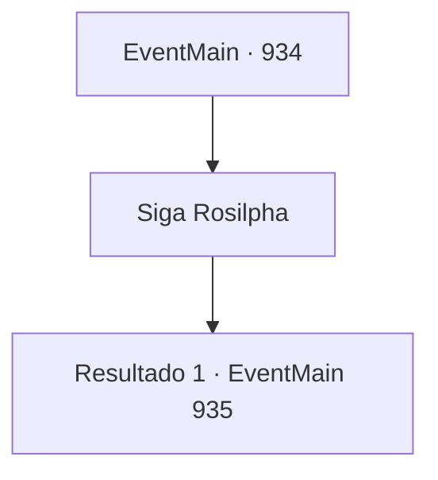

# Eventos principais · 934

[Índice da tabela](index.md) · [Índice geral](../index.md)

ID: `pt:EventMain:934` · Fonte: `EventMain4` · Versão: 1.2.47.

Mapeamento estático dos arquivos; a disponibilidade e a execução dependem do estado da run.

## Texto do evento

*Sem texto no arquivo.*

## Dados de entrada

```json
{
  "id": 934,
  "grade": 1,
  "normalGoal": "",
  "required": ""
}
```

## Mapa das escolhas



## Escolhas e resultados

### Escolha 1

Siga Rosilpha

Requisitos e outros campos da escolha:

```json
{
  "required": ""
}
```

#### Resultado 1.1

Rosilpha lidera, com você e Naverr seguindo atrás. Alguns dos gripplis avistam Rosilpha enquanto separam as plantas aquáticas. Eles fazem um som de desaprovação para Rosilpha. 

 "Vagando para lá e para cá, adiando a agricultura..."

 Há aquele que lutou com Rosilpha alguns dias atrás. Mas, ao contrário do que aconteceu antes, ele segue direto para a casa do ancião, sem dar atenção a eles.

Continuação registrada: [Evento 935](0935.md) na mesma tabela.

```json
{
  "required": "",
  "chance": "1",
  "nextEvent": 935,
  "type": 2,
  "reward": ""
}
```

## Referências que chegam a este evento

- [Evento 933 · escolha 1 · resultado 1](0933.md#escolha-1)
