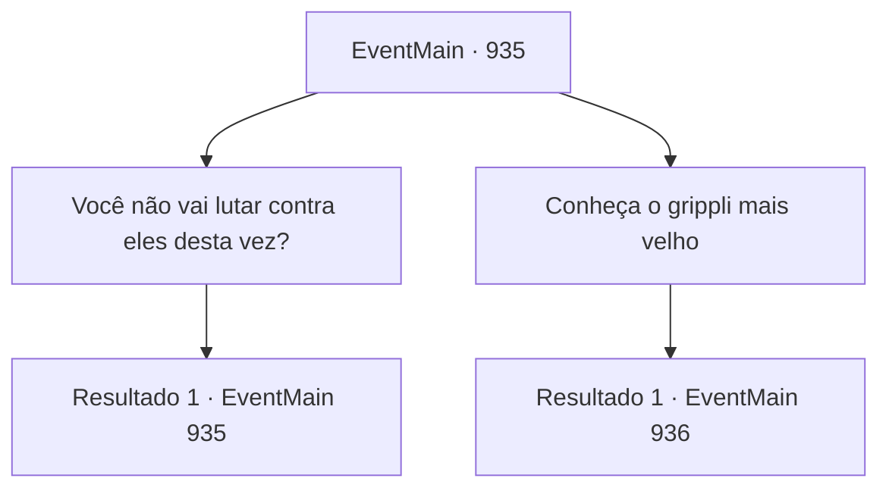

# Eventos principais · 935

[Índice da tabela](index.md) · [Índice geral](../index.md)

ID: `pt:EventMain:935` · Fonte: `EventMain4` · Versão: 1.2.47.

Mapeamento estático dos arquivos; a disponibilidade e a execução dependem do estado da run.

## Texto do evento

*Sem texto no arquivo.*

## Dados de entrada

```json
{
  "id": 935,
  "grade": 1,
  "normalGoal": "",
  "required": ""
}
```

## Mapa das escolhas



## Escolhas e resultados

### Escolha 1

Você não vai lutar contra eles desta vez?

Requisitos e outros campos da escolha:

```json
{
  "required": "5_674_0"
}
```

#### Resultado 1.1

Rosilpha respondeu, dando de ombros. 

 "Bem... Eu não me importo mais. Eles que são os infelizes. Estou focando em uma missão mais importante, qual é o sentido de lutar contra eles?"


Continuação registrada: [Evento 935](0935.md) na mesma tabela.

```json
{
  "required": "",
  "chance": "1",
  "nextEvent": 935,
  "type": 2,
  "reward": "5_674_1"
}
```

### Escolha 2

Conheça o grippli mais velho

Requisitos e outros campos da escolha:

```json
{
  "required": ""
}
```

#### Resultado 2.1

Você encontra o ancião grippli novamente. Rosilpha conta a ele tudo o que aconteceu, dizendo que estão aqui para destruir os artefatos que podem abrir o portal para o Plano Astral. O ancião os examina cuidadosamente antes de falar. 

 "Hm... Se não houver uma maneira física de destruí-los... Talvez precisemos consultar a Serpente Divina."

 Então, uma faísca atinge o chão com uma explosão alta. 

 "O- o que é isso...!"

 Você avista uma água-viva gigante flutuando no céu. Ela então começa a disparar raios de energia de seus tentáculos. A Erva-de-Pato Flutuante é devastada, e devoradores de almas emergem da fumaça negra. Lá está também a Rainha, que você conheceu antes. Ela emana um forte senso de dominação, pressionando a todos. 

 "Vocês nos entregarão os artefatos. Ou, todos aqui enfrentarão a morte."


Continuação registrada: [Evento 936](0936.md) na mesma tabela.

```json
{
  "required": "",
  "chance": "1",
  "nextEvent": 936,
  "type": 2,
  "reward": ""
}
```

## Referências que chegam a este evento

- [Evento 934 · escolha 1 · resultado 1](0934.md#escolha-1)
- [Evento 935 · escolha 1 · resultado 1](0935.md#escolha-1)
