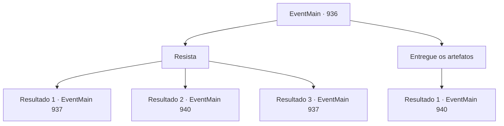

# Eventos principais · 936

[Índice da tabela](index.md) · [Índice geral](../index.md)

ID: `pt:EventMain:936` · Fonte: `EventMain4` · Versão: 1.2.47.

Mapeamento estático dos arquivos; a disponibilidade e a execução dependem do estado da run.

## Texto do evento

*Sem texto no arquivo.*

## Dados de entrada

```json
{
  "id": 936,
  "grade": 1,
  "normalGoal": "",
  "required": ""
}
```

## Mapa das escolhas



## Escolhas e resultados

### Escolha 1

Resista

Requisitos e outros campos da escolha:

```json
{
  "required": ""
}
```

#### Resultado 1.1

Você resiste à dominação da Rainha. Quando olha ao redor, percebe que é o único que conseguiu resistir. Eles estão tremendo, como sapos diante de uma cobra. 

 "N-nós... nós não podemos...!"


Continuação registrada: [Evento 937](0937.md) na mesma tabela.

```json
{
  "required": "24_7_1",
  "chance": "1|0_12_1",
  "nextEvent": 937,
  "type": 0,
  "reward": ""
}
```

#### Resultado 1.2

Você tenta resistir à dominação da Rainha. Mas seu corpo não se move. Ninguém é capaz de resistir à Rainha. Sorrindo satisfeita, a Rainha leva os artefatos embora. 

 "Obrigada. Tudo isso... é para você."

 Ao virar as costas para sair, ela acrescenta. 

 "Então - nem pense em interferir novamente. Se você me desafiar... algo terrível acontecerá."

 A Rainha e seus subordinados voltam para a água-viva gigante, pairando sobre os tentáculos. A água-viva então voa para longe. Só então os gripplis conseguem respirar novamente. 

 "*ofegante*... *ofegante*..."

 Você pode ouvi-los exalando e engasgando. Rosilpha fala, preocupada. 

 "E agora... o que faremos?"


Continuação registrada: [Evento 940](0940.md) na mesma tabela.

```json
{
  "required": "24_7_1",
  "chance": "20",
  "nextEvent": 940,
  "type": 1,
  "reward": "4_315_1|4_316_1"
}
```

#### Resultado 1.3

Você resiste à dominação da Rainha. Quando olha ao redor, percebe que é o único que conseguiu resistir. Eles estão tremendo, como sapos diante de uma cobra. 

 "N-nós... nós não podemos...!"


Continuação registrada: [Evento 937](0937.md) na mesma tabela.

```json
{
  "required": "23_7_1",
  "chance": "1",
  "nextEvent": 937,
  "type": 2,
  "reward": ""
}
```

### Escolha 2

Entregue os artefatos

Requisitos e outros campos da escolha:

```json
{
  "required": ""
}
```

#### Resultado 2.1

Você entrega os artefatos para a Rainha. Sorrindo satisfeita, a Rainha leva os artefatos embora. 

 "Obrigada. Tudo isso... é para você."

 Enquanto está virando as costas para sair, ela acrescenta. 

 "Então - nem pense em interferir novamente. Se você me desafiar... algo terrível acontecerá."

 A Rainha e seus subordinados voltam para a água-viva gigante, pairando sobre os tentáculos. A água-viva então voa para longe. Somente então os gripplis podem respirar novamente. 

 "*ofegante*... *ofegante*..."

 Você pode ouvi-los exalando e engasgando. Rosilpha fala, preocupada. 

 "E agora... o que faremos?"


Continuação registrada: [Evento 940](0940.md) na mesma tabela.

```json
{
  "required": "",
  "chance": "1",
  "nextEvent": 940,
  "type": 2,
  "reward": "4_315_1|4_316_1"
}
```

## Referências que chegam a este evento

- [Evento 935 · escolha 2 · resultado 1](0935.md#escolha-2)
