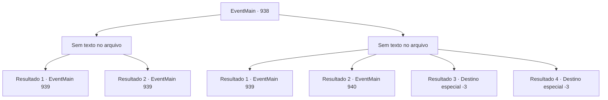

# Eventos principais · 938

[Índice da tabela](index.md) · [Índice geral](../index.md)

ID: `pt:EventMain:938` · Fonte: `EventMain4` · Versão: 1.2.47.

Mapeamento estático dos arquivos; a disponibilidade e a execução dependem do estado da run.

## Texto do evento

*Sem texto no arquivo.*

## Dados de entrada

```json
{
  "id": 938,
  "grade": 1,
  "normalGoal": "",
  "required": ""
}
```

## Mapa das escolhas



## Escolhas e resultados

### Escolha 1

*Sem texto no arquivo; o papel dessa opção depende da interface do jogo.*

Requisitos e outros campos da escolha:

```json
{
  "required": ""
}
```

#### Resultado 1.1

Você, Rosilpha, Naverr e os gripplis atacam os devoradores de almas com toda a sua força, transformando-os em adubo um por um. Vendo como a batalha está indo, a Rainha levanta seus dedos esguios. Então, dos tentáculos do navio, a energia é reunida novamente, e começa um bombardeio.

Continuação registrada: [Evento 939](0939.md) na mesma tabela.

```json
{
  "required": "5_685_1",
  "chance": "1",
  "nextEvent": 939,
  "type": 2,
  "reward": ""
}
```

#### Resultado 1.2

Você e Rosilpha lutam contra os gripplis, transformando-os em adubo um por um. Vendo como a batalha está indo, a Rainha levanta seus dedos esguios. Então, dos tentáculos da nave, a energia é reunida novamente, e começa um bombardeio.

Continuação registrada: [Evento 939](0939.md) na mesma tabela.

```json
{
  "required": "5_685_2",
  "chance": "1",
  "nextEvent": 939,
  "type": 2,
  "reward": ""
}
```

### Escolha 2

*Sem texto no arquivo; o papel dessa opção depende da interface do jogo.*

Requisitos e outros campos da escolha:

```json
{
  "required": ""
}
```

#### Resultado 2.1

Você é jogado ao chão lamacento pelos devoradores de almas. Assim que um guerreiro devoralmas está prestes a tirar sua vida, Naverr balança seu facão e corta seu pescoço. 

 "Vamos. Levante."

 Ele estende as mãos, ajudando você a se levantar. Quando você olha ao redor, os gripplis estão defendendo com sucesso contra os devoradores de almas. Um por um, as criaturas retorcidas são transformadas em adubo. Vendo como a batalha está indo, a Rainha levanta seus dedos esguios. Então, dos tentáculos do navio, a energia é reunida novamente, e começa um bombardeio.

Continuação registrada: [Evento 939](0939.md) na mesma tabela.

```json
{
  "required": "5_685_1",
  "chance": "1",
  "nextEvent": 939,
  "type": 2,
  "reward": ""
}
```

#### Resultado 2.2

Você e Rosilpha lutam contra os devoradores de almas, mas o número deles é tão grande que ambos são sobrecarregados. Infelizmente, você é jogado ao chão lamacento por eles, e é impotente para impedi-los de levar os artefatos embora. Sorrindo satisfeita, a Rainha leva os artefatos embora. 

 "Obrigado. Tudo isso... é para você."

 Ao virar as costas para sair, ela acrescenta. 

 "Então - nem pense em interferir novamente. Se você me desafiar... algo terrível acontecerá."

 A Rainha e seus subordinados voltam para a água-viva gigante, pairando sobre os tentáculos. A água-viva então voa para longe. Só então os gripplis conseguem respirar novamente. 

 "*ofegante*... *ofegante*..."

 Você pode ouvi-los exalando e engasgando. Rosilpha fala, preocupada. 

 "Então... o que fazemos agora?"


Continuação registrada: [Evento 940](0940.md) na mesma tabela.

```json
{
  "required": "5_685_2|1_0_2|1_1_2",
  "chance": "1",
  "nextEvent": 940,
  "type": 2,
  "reward": "4_315_1|4_316_1|0_0_-1|0_1_-1"
}
```

#### Resultado 2.3

Você e Rosilpha lutam contra os devoradores de almas, mas o número deles é tão grande que ambos são dominados. Infelizmente, você é jogado no chão lamacento por eles, e um dos tentáculos perfura seu corpo, tirando sua vida.

Continuação registrada: [Destino especial `-3`](../destinos-especiais.md).

```json
{
  "required": "5_685_2|2_0_2",
  "chance": "1",
  "nextEvent": -3,
  "type": 2,
  "reward": "0_0_-1|0_1_-1"
}
```

#### Resultado 2.4

Você e Rosilpha lutam contra os devoradores de almas, mas o número deles é tão grande que ambos são dominados. Infelizmente, você é jogado no chão lamacento por eles, e um dos tentáculos perfura seu corpo, tirando sua vida.

Continuação registrada: [Destino especial `-3`](../destinos-especiais.md).

```json
{
  "required": "5_685_2|2_1_2",
  "chance": "1",
  "nextEvent": -3,
  "type": 2,
  "reward": "0_0_-1|0_1_-1"
}
```

## Referências que chegam a este evento

- [Evento 937 · escolha 1 · resultado 1](0937.md#escolha-1)
- [Evento 937 · escolha 1 · resultado 2](0937.md#escolha-1)
- [Evento 937 · escolha 2 · resultado 1](0937.md#escolha-2)
- [Evento 937 · escolha 2 · resultado 2](0937.md#escolha-2)
