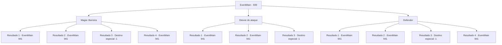

# Eventos principais · 939

[Índice da tabela](index.md) · [Índice geral](../index.md)

ID: `pt:EventMain:939` · Fonte: `EventMain4` · Versão: 1.2.47.

Mapeamento estático dos arquivos; a disponibilidade e a execução dependem do estado da run.

## Texto do evento

*Sem texto no arquivo.*

## Dados de entrada

```json
{
  "id": 939,
  "grade": 1,
  "normalGoal": "",
  "required": ""
}
```

## Mapa das escolhas



## Escolhas e resultados

### Escolha 1

Magia: Barreira

Requisitos e outros campos da escolha:

```json
{
  "required": "20_0_2|1_1_2"
}
```

#### Resultado 1.1

Você conjura uma barreira, bloqueando o bombardeio. Alguns gripplis próximos a você conseguem evitar a destruição, e alguns milagrosamente sobrevivem, mas uma grande parte dos gripplis e devoradores de almas são reduzidos a cinzas. À medida que a fumaça se dissipa, você percebe que a nave dos devoradores de almas está descendo ao chão. Ela começa a reunir energia novamente, como se estivesse tentando explodir toda a selva. 

 "A- acabou agora...!"

 Uma voz murmura. O desespero logo se espalha para os outros. Então, a selva começa a tremer, enquanto uma serpente tecida com milhares de cipós de árvores aparece. A serpente enlaça a nave com seu corpo, lançando-a ao chão enlameado. 

 "A- é a Serpente Divina...! A Serpente Divina luta conosco!"

 Enquanto o grippli mais velho comenta extasiado, outros gripplis também são mobilizados. Então, Naverr se aproxima de você e fala. 

 "Agora é a chance de lidar com a Rainha."

 Enquanto a batalha entre os devoradores de almas e os gripplis está acontecendo, você vê a Rainha voando de volta para a nave.

Continuação registrada: [Evento 941](0941.md) na mesma tabela.

```json
{
  "required": "21_0_4",
  "chance": "1|0_7_1|0_12_1",
  "nextEvent": 941,
  "type": 0,
  "reward": "0_1_-1"
}
```

#### Resultado 1.2

Você conjura uma barreira, tentando bloquear o bombardeio. Mas sua barreira se despedaça, e você é lançado para longe pelas explosões. Uma grande parte dos gripplis e devoradores de almas são reduzidos a cinzas também. À medida que a fumaça se dissipa, você percebe que a nave dos devoradores de almas está descendo ao chão. Começa a reunir energia novamente, como se estivesse tentando explodir toda a selva. 

 "Acabou agora...!"

 Uma voz murmura. O desespero logo se espalha para os outros. Então, a selva começa a tremer, enquanto uma serpente tecida com milhares de cipós de árvores aparece. A serpente enlaça a nave com seu corpo, lançando-a ao chão enlameado. 

 "É a Serpente Divina...! A Serpente Divina luta conosco!"

 Enquanto o grippli mais velho comenta extasiado, outros gripplis também são mobilizados. Então, Naverr se aproxima de você e fala. 

 "Agora é a chance de lidar com a Rainha."

 Enquanto a batalha entre os devoradores de almas e os gripplis está acontecendo, você vê a Rainha voando de volta para a nave.

Continuação registrada: [Evento 941](0941.md) na mesma tabela.

```json
{
  "required": "1_0_2|21_0_4",
  "chance": "40",
  "nextEvent": 941,
  "type": 1,
  "reward": "0_0_-1|0_1_-1"
}
```

#### Resultado 1.3

Você conjura uma barreira, tentando bloquear o bombardeio. Mas sua barreira se despedaça, e as explosões te atingem diretamente. Ai de você, reduzido a nada além de cinzas.

Continuação registrada: [Destino especial `-1`](../destinos-especiais.md).

```json
{
  "required": "2_0_2|21_0_4",
  "chance": "40",
  "nextEvent": -1,
  "type": 1,
  "reward": "0_0_-1|0_1_-1|25_8_1|15_6_0"
}
```

#### Resultado 1.4

Você conjura uma barreira, bloqueando o bombardeio. Alguns gripplis próximos a você conseguem evitar a destruição, e alguns milagrosamente sobrevivem, mas uma grande parte dos gripplis e devoradores de almas são reduzidos a cinzas. À medida que a fumaça se dissipa, você percebe que a nave dos devoradores de almas está descendo ao chão. Ela começa a reunir energia novamente, como se estivesse tentando explodir toda a selva. 

 "A- acabou agora...!"

 Uma voz murmura. O desespero logo se espalha para os outros. Então, a selva começa a tremer, enquanto uma serpente tecida com milhares de cipós de árvores aparece. A serpente enlaça a nave com seu corpo, lançando-a ao chão enlameado. 

 "A- é a Serpente Divina...! A Serpente Divina luta conosco!"

 Enquanto o grippli mais velho comenta extasiado, outros gripplis também são mobilizados. Então, Naverr se aproxima de você e fala. 

 "Agora é a chance de lidar com a Rainha."

 Enquanto a batalha entre os devoradores de almas e os gripplis está acontecendo, você vê a Rainha voando de volta para a nave.

Continuação registrada: [Evento 941](0941.md) na mesma tabela.

```json
{
  "required": "20_0_4",
  "chance": "1",
  "nextEvent": 941,
  "type": 2,
  "reward": "0_1_-1"
}
```

### Escolha 2

Desvie do ataque

Requisitos e outros campos da escolha:

```json
{
  "required": ""
}
```

#### Resultado 2.1

Você pula de aguapé em aguapé, evitando as explosões. Poucos gripplis perto de você conseguem evitar a destruição, e alguns milagrosamente sobrevivem, mas uma grande parte dos gripplis e devoradores de almas são reduzidos a cinzas. À medida que a fumaça se dissipa, você percebe que a nave dos devoradores de almas está descendo ao chão. Começa a reunir energia novamente, como se estivesse tentando explodir toda a selva. 

 "É- acabou agora...!"

 Uma voz murmura. O desespero logo se espalha para os outros. Então, a selva começa a tremer, enquanto uma serpente tecida com milhares de cipós de árvores aparece. A serpente enlaça a nave com seu corpo, lançando-a ao chão enlameado. 

 "É- é a Serpente Divina...! A Serpente Divina luta conosco!"

 Enquanto o grippli mais velho comenta extasiado, outros gripplis também são mobilizados. Então, Naverr se aproxima de você e fala. 

 "Agora é a chance de lidar com a Rainha."

 Enquanto a batalha entre os devoradores de almas e os gripplis está acontecendo, você vê a Rainha voando de volta para a nave.

Continuação registrada: [Evento 941](0941.md) na mesma tabela.

```json
{
  "required": "",
  "chance": "1|0_6_1",
  "nextEvent": 941,
  "type": 0,
  "reward": ""
}
```

#### Resultado 2.2

Você tenta evitar os bombardeios, mas não consegue escapar de cada explosão e onda de choque. Uma grande parte dos gripplis e devoradores de almas também são reduzidos a cinzas. À medida que a fumaça se dissipa, você percebe que a nave dos devoradores de almas está descendo ao chão. Ela começa a reunir energia novamente, como se estivesse tentando explodir toda a selva. 

 "É... acabou agora...!"

 Uma voz murmura. O desespero logo se espalha para os outros. Então, a selva começa a tremer, enquanto uma serpente tecida com milhares de cipós de árvores aparece. A serpente enlaça a nave com seu corpo, lançando-a ao chão enlameado. 

 "É... a Serpente Divina...! A Serpente Divina luta conosco!"

 Enquanto o grippli mais velho comenta extasiado, outros gripplis também são mobilizados. Então, Naverr se aproxima de você e fala. 

 "Agora é a chance de lidar com a Rainha."

 Enquanto a batalha entre os devoradores de almas e os gripplis está acontecendo, você vê a Rainha voando de volta para a nave.

Continuação registrada: [Evento 941](0941.md) na mesma tabela.

```json
{
  "required": "1_0_2",
  "chance": "26",
  "nextEvent": 941,
  "type": 1,
  "reward": "0_0_-1"
}
```

#### Resultado 2.3

Você tenta evitar o bombardeio, mas não consegue.  Infelizmente, você é reduzido a nada além de cinzas.

Continuação registrada: [Destino especial `-1`](../destinos-especiais.md).

```json
{
  "required": "2_0_2",
  "chance": "26",
  "nextEvent": -1,
  "type": 1,
  "reward": "0_0_-1|0_1_-1|15_6_0|25_8_1"
}
```

### Escolha 3

Defender

Requisitos e outros campos da escolha:

```json
{
  "required": "20_9_1"
}
```

#### Resultado 3.1

Você mal consegue desviar do bombardeio. Alguns gripplis próximos a você conseguem evitar a destruição, e alguns milagrosamente sobrevivem, mas uma grande parte dos gripplis e devoradores de almas são reduzidos a cinzas. À medida que a fumaça se dissipa, você percebe que a nave dos devoradores de almas está descendo ao chão. Começa a reunir energia novamente, como se estivesse tentando explodir toda a selva. 

 "A- acabou agora...!"

 Uma voz murmura. O desespero logo se espalha para os outros. Então, a selva começa a tremer, enquanto uma serpente tecida com milhares de cipós de árvores aparece. A serpente enlaça a nave com seu corpo, lançando-a ao chão lamacento. 

 "A- é a Serpente Divina...! A Serpente Divina luta conosco!"

 Enquanto o grippli mais velho comenta extasiado, outros gripplis também são mobilizados. Então, Naverr se aproxima de você e fala. 

 "Agora é a chance de lidar com a Rainha."

 Enquanto a batalha entre os devoradores de almas e os gripplis está acontecendo, você vê a Rainha voando de volta para a nave.

Continuação registrada: [Evento 941](0941.md) na mesma tabela.

```json
{
  "required": "21_9_4",
  "chance": "1|0_13_1",
  "nextEvent": 941,
  "type": 0,
  "reward": ""
}
```

#### Resultado 3.2

Você tenta desviar o bombardeio, mas em vez disso a onda de choque te joga em uma árvore próxima. Poucos gripplis perto de você conseguem evitar a destruição, e alguns milagrosamente sobrevivem, mas uma grande parte dos gripplis e devoradores de almas são reduzidos a cinzas. Conforme a fumaça se dissipa, você percebe que a nave dos devoradores de almas está descendo ao chão. Começa a reunir energia novamente, como se estivesse tentando explodir toda a selva. 

 "A- acabou agora...!"

 uma voz murmura. O desespero logo se espalha para os outros. Então, a selva começa a tremer, enquanto uma serpente tecida com milhares de cipós de árvores aparece. A serpente enlaça a nave com seu corpo, jogando-a no chão enlameado. 

 "A- é a Serpente Divina...! A Serpente Divina luta conosco!"

 Como o grippli mais velho comenta extasiado, outros gripplis também são mobilizados. Então, Naverr se aproxima de você e fala. 

 "Agora é a chance de lidar com a Rainha."

 Enquanto a batalha entre os devoradores de almas e os gripplis está acontecendo, você vê a Rainha voando de volta para a nave.

Continuação registrada: [Evento 941](0941.md) na mesma tabela.

```json
{
  "required": "21_9_4|1_0_2",
  "chance": "25",
  "nextEvent": 941,
  "type": 1,
  "reward": "0_0_-1"
}
```

#### Resultado 3.3

Você tenta desviar da explosão, mas em vez disso a onda de choque te joga em uma árvore próxima. Assim, sua consciência desaparece.

Continuação registrada: [Destino especial `-1`](../destinos-especiais.md).

```json
{
  "required": "21_9_4|2_0_2",
  "chance": "25",
  "nextEvent": -1,
  "type": 1,
  "reward": "0_0_-1|0_1_-1|15_6_0|25_8_1"
}
```

#### Resultado 3.4

Você mal consegue desviar do bombardeio. Poucos gripplis perto de você conseguem evitar a destruição, e alguns milagrosamente sobrevivem, mas uma grande parte dos gripplis e devoradores de almas são reduzidos a cinzas. À medida que a fumaça se dissipa, você percebe que a nave dos devoradores de almas está descendo ao chão. Começa a reunir energia novamente, como se estivesse tentando explodir toda a selva. 

 "A- acabou agora...!"

 Uma voz murmura. O desespero logo se espalha para os outros. Então, a selva começa a tremer, enquanto uma serpente tecida com milhares de cipós de árvores aparece. A serpente enlaça a nave com seu corpo, lançando-a ao chão lamacento. 

 "A- é a Serpente Divina...! A Serpente Divina luta conosco!"

 Enquanto o grippli mais velho comenta extasiado, outros gripplis também são mobilizados. Então, Naverr se aproxima de você e fala. 

 "Agora é a chance de lidar com a Rainha."

 Enquanto a batalha entre os devoradores de almas e os gripplis está acontecendo, você vê a Rainha voando de volta para a nave.

Continuação registrada: [Evento 941](0941.md) na mesma tabela.

```json
{
  "required": "20_9_4",
  "chance": "1",
  "nextEvent": 941,
  "type": 2,
  "reward": ""
}
```

## Referências que chegam a este evento

- [Evento 938 · escolha 1 · resultado 1](0938.md#escolha-1)
- [Evento 938 · escolha 1 · resultado 2](0938.md#escolha-1)
- [Evento 938 · escolha 2 · resultado 1](0938.md#escolha-2)
