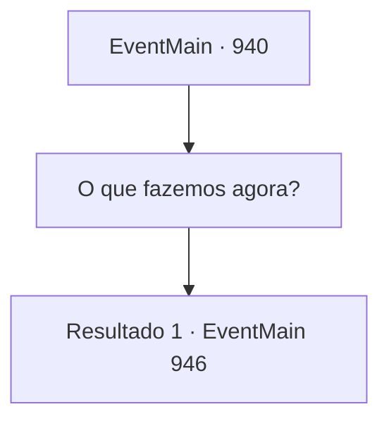

# Eventos principais · 940

[Índice da tabela](index.md) · [Índice geral](../index.md)

ID: `pt:EventMain:940` · Fonte: `EventMain4` · Versão: 1.2.47.

Mapeamento estático dos arquivos; a disponibilidade e a execução dependem do estado da run.

## Texto do evento

*Sem texto no arquivo.*

## Dados de entrada

```json
{
  "id": 940,
  "grade": 1,
  "normalGoal": "",
  "required": ""
}
```

## Mapa das escolhas



## Escolhas e resultados

### Escolha 1

O que fazemos agora?

Requisitos e outros campos da escolha:

```json
{
  "required": ""
}
```

#### Resultado 1.1

Você falha em encontrar qualquer coisa. Então, o grippli mais velho sugere uma resposta para a pergunta de Rosilpha. 

 "Devemos pedir a ajuda da Serpente Divina."

 O grippli mais velho corre até o totem da Serpente Divina e começa a rezar. Enquanto ele explica tudo o que aconteceu até agora, os olhos do totem começam a brilhar, e a voz da Serpente Divina flui dele. 

 "Vá. Com meu avatar. Impedir que eles entrem no Plano Astral."

 Assim que a voz cessa, a selva começa a tremer, e uma serpente feita de milhares de cipós de árvores aparece. 

 "É a Serpente Divina...! A Serpente Divina luta conosco!"

 Enquanto o grippli mais velho comenta extasiado, outros gripplis também são convocados. 

 "Vamos. Eles devem ter ido para o Olho Azul."


Continuação registrada: [Evento 946](0946.md) na mesma tabela.

```json
{
  "required": "",
  "chance": "1",
  "nextEvent": 946,
  "type": 2,
  "reward": ""
}
```

## Referências que chegam a este evento

- [Evento 936 · escolha 1 · resultado 2](0936.md#escolha-1)
- [Evento 936 · escolha 2 · resultado 1](0936.md#escolha-2)
- [Evento 938 · escolha 2 · resultado 2](0938.md#escolha-2)
