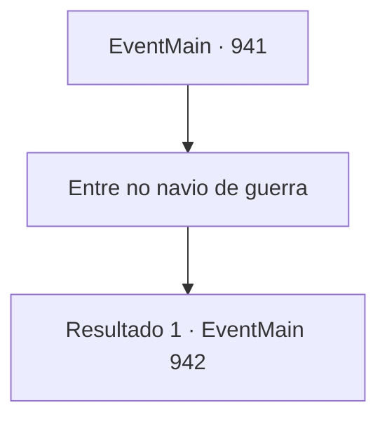

# Eventos principais · 941

[Índice da tabela](index.md) · [Índice geral](../index.md)

ID: `pt:EventMain:941` · Fonte: `EventMain4` · Versão: 1.2.47.

Mapeamento estático dos arquivos; a disponibilidade e a execução dependem do estado da run.

## Texto do evento

*Sem texto no arquivo.*

## Dados de entrada

```json
{
  "id": 941,
  "grade": 1,
  "normalGoal": "",
  "required": ""
}
```

## Mapa das escolhas



## Escolhas e resultados

### Escolha 1

Entre no navio de guerra

Requisitos e outros campos da escolha:

```json
{
  "required": ""
}
```

#### Resultado 1.1

Você está prestes a entrar no navio de guerra, quando Rosilpha pergunta, preocupada. 

 "Espera. O que fazemos quando um de nós falha em resistir à dominação da Rainha?"


Continuação registrada: [Evento 942](0942.md) na mesma tabela.

```json
{
  "required": "",
  "chance": "1",
  "nextEvent": 942,
  "type": 2,
  "reward": ""
}
```

## Referências que chegam a este evento

- [Evento 939 · escolha 1 · resultado 1](0939.md#escolha-1)
- [Evento 939 · escolha 1 · resultado 2](0939.md#escolha-1)
- [Evento 939 · escolha 1 · resultado 4](0939.md#escolha-1)
- [Evento 939 · escolha 2 · resultado 1](0939.md#escolha-2)
- [Evento 939 · escolha 2 · resultado 2](0939.md#escolha-2)
- [Evento 939 · escolha 3 · resultado 1](0939.md#escolha-3)
- [Evento 939 · escolha 3 · resultado 2](0939.md#escolha-3)
- [Evento 939 · escolha 3 · resultado 4](0939.md#escolha-3)
- [Evento 946 · escolha 1 · resultado 1](0946.md#escolha-1)
