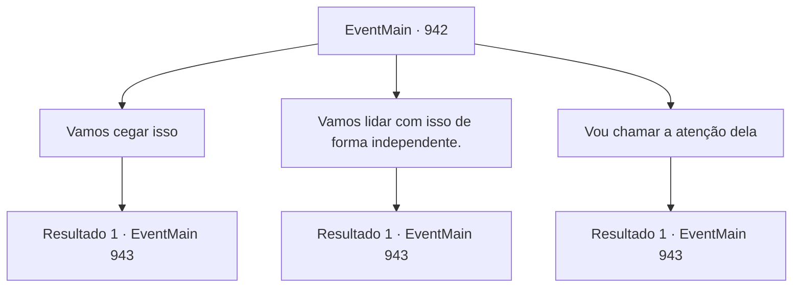

# Eventos principais · 942

[Índice da tabela](index.md) · [Índice geral](../index.md)

ID: `pt:EventMain:942` · Fonte: `EventMain4` · Versão: 1.2.47.

Mapeamento estático dos arquivos; a disponibilidade e a execução dependem do estado da run.

## Texto do evento

*Sem texto no arquivo.*

## Dados de entrada

```json
{
  "id": 942,
  "grade": 1,
  "normalGoal": "",
  "required": ""
}
```

## Mapa das escolhas



## Escolhas e resultados

### Escolha 1

Vamos cegar isso

Requisitos e outros campos da escolha:

```json
{
  "required": ""
}
```

#### Resultado 1.1

Lembra que quando você travou olhares com a Rainha, sentiu sua dominação. Sua ideia é bloquear sua visão, para que ela não possa ver. Então, Naverr tira um cilindro prateado de sua mochila. 

 "Este é um cilindro de névoa de flash de uso único Mark-I Quando você puxar o fusível aqui, ele criará uma explosão de flash, e então produzirá uma fumaça espessa."

 Ele diz que o carrega consigo para sair de situações perigosas. No entanto, ele também acrescenta que, devido ao quão alto e brilhante é, Naverr mesmo só o usou uma vez em perigo real. 

 "Fiz para fugir de monstros, mas acontece que essa coisa atrai monstros. De qualquer forma. Vamos lá."


Continuação registrada: [Evento 943](0943.md) na mesma tabela.

```json
{
  "required": "",
  "chance": "1",
  "nextEvent": 943,
  "type": 2,
  "reward": "5_686_1"
}
```

### Escolha 2

Vamos lidar com isso de forma independente.

Requisitos e outros campos da escolha:

```json
{
  "required": ""
}
```

#### Resultado 2.1

Você responde que lidar com isso deve ser feito de forma independente. Rosilpha parece um pouco preocupada, mas também não consegue pensar em uma ideia. 

 "Hmm... Tudo bem. Vamos então."


Continuação registrada: [Evento 943](0943.md) na mesma tabela.

```json
{
  "required": "",
  "chance": "1",
  "nextEvent": 943,
  "type": 2,
  "reward": "5_687_1"
}
```

### Escolha 3

Vou chamar a atenção dela

Requisitos e outros campos da escolha:

```json
{
  "required": ""
}
```

#### Resultado 3.1

Você responde que tentará distrair a Rainha. Então, Rosilpha e Naverr aproveitarão a oportunidade e atacarão, a parte crucial do plano sendo não dar à Rainha a chance de afirmar sua dominação. Naverr concorda com um aceno. 

 "Acho que é uma boa ideia. Se você conseguir fazer com que ela se concentre em você, deveríamos ser capazes de atacar. De qualquer forma. Vamos."


Continuação registrada: [Evento 943](0943.md) na mesma tabela.

```json
{
  "required": "",
  "chance": "1",
  "nextEvent": 943,
  "type": 2,
  "reward": "5_688_1"
}
```

## Referências que chegam a este evento

- [Evento 941 · escolha 1 · resultado 1](0941.md#escolha-1)
