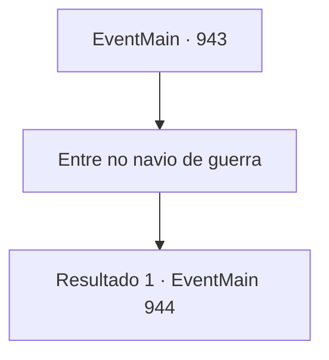

# Eventos principais · 943

[Índice da tabela](index.md) · [Índice geral](../index.md)

ID: `pt:EventMain:943` · Fonte: `EventMain4` · Versão: 1.2.47.

Mapeamento estático dos arquivos; a disponibilidade e a execução dependem do estado da run.

## Texto do evento

*Sem texto no arquivo.*

## Dados de entrada

```json
{
  "id": 943,
  "grade": 1,
  "normalGoal": "",
  "required": ""
}
```

## Mapa das escolhas



## Escolhas e resultados

### Escolha 1

Entre no navio de guerra

Requisitos e outros campos da escolha:

```json
{
  "required": ""
}
```

#### Resultado 1.1

Você, Rosilpha e Naverr entram na nave do devoralmas. O interior da nave é composto por tecido biológico de cor roxa-claro, e conforme você avança mais para dentro, as cores se intensificam. A estrutura labiríntica torna difícil a navegação. 

 "Parece que estamos dentro da barriga de uma criatura gigante. Aliás, para onde devemos ir?"

 Assim que Rosilpha termina de falar, um grupo de devoradores de almas aparece, bloqueando o seu caminho.

Continuação registrada: [Evento 944](0944.md) na mesma tabela.

```json
{
  "required": "",
  "chance": "1",
  "nextEvent": 944,
  "type": 2,
  "reward": "6_0_170",
  "place": 15
}
```

## Referências que chegam a este evento

- [Evento 942 · escolha 1 · resultado 1](0942.md#escolha-1)
- [Evento 942 · escolha 2 · resultado 1](0942.md#escolha-2)
- [Evento 942 · escolha 3 · resultado 1](0942.md#escolha-3)
