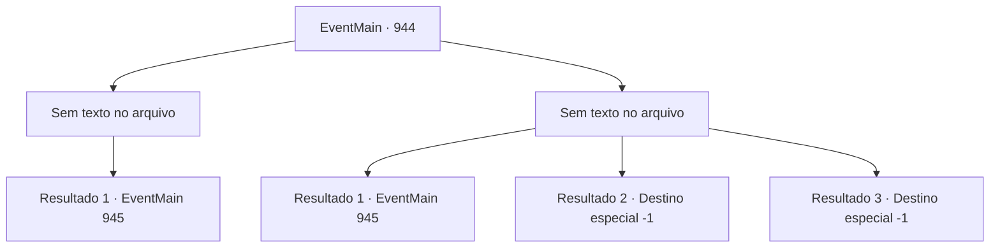

# Eventos principais · 944

[Índice da tabela](index.md) · [Índice geral](../index.md)

ID: `pt:EventMain:944` · Fonte: `EventMain4` · Versão: 1.2.47.

Mapeamento estático dos arquivos; a disponibilidade e a execução dependem do estado da run.

## Texto do evento

*Sem texto no arquivo.*

## Dados de entrada

```json
{
  "id": 944,
  "grade": 1,
  "normalGoal": "",
  "required": ""
}
```

## Mapa das escolhas



## Escolhas e resultados

### Escolha 1

*Sem texto no arquivo; o papel dessa opção depende da interface do jogo.*

Requisitos e outros campos da escolha:

```json
{
  "required": ""
}
```

#### Resultado 1.1

Você tira a vida dos devoradores de almas que cruzaram seu caminho. Seu grupo avança mais fundo no navio de guerra. Enquanto isso, parece que uma batalha feroz está acontecendo lá fora. O navio treme de choque, você ouve o som de rugidos e gritos misturados. Enquanto isso, Naverr permanece calmo. 

 "Aqui. Isso parece ser... uma porta?"

 Onde ele aponta é uma porta redonda coberta com algum tipo de veias metálicas de sangue. Há uma joia avermelhada no meio da porta. Naverr começa a examinar o que está escrito perto da joia. 

 "Hum... Não consigo entender isso..."


Continuação registrada: [Evento 945](0945.md) na mesma tabela.

```json
{
  "required": "",
  "chance": "1",
  "nextEvent": 945,
  "type": 2,
  "reward": ""
}
```

### Escolha 2

*Sem texto no arquivo; o papel dessa opção depende da interface do jogo.*

Requisitos e outros campos da escolha:

```json
{
  "required": ""
}
```

#### Resultado 2.1

Os devoradores de almas te nocauteiam com seus raios. Enquanto isso, Rosilpha e Naverr derrotam os devoradores de almas. 

 "Tudo bem?"

 Rosilpha vem em seu auxílio, ajudando você a se levantar. Sua equipe avança mais fundo no navio de guerra. Enquanto isso, parece que uma batalha feroz está acontecendo lá fora. O navio treme de choque, você ouve o som de rugidos misturados e gritos. Enquanto isso, Naverr permanece calmo. 

 "Aqui. Isso parece ser... uma porta?"

 Onde ele aponta é uma porta redonda coberta com algum tipo de veias de sangue metálico. Há uma joia avermelhada no meio da porta. Naverr começa a examinar o que está escrito perto da joia. 

 "Hum... Não consigo entender isso..."


Continuação registrada: [Evento 945](0945.md) na mesma tabela.

```json
{
  "required": "1_0_2|1_1_2",
  "chance": "1",
  "nextEvent": 945,
  "type": 2,
  "reward": "0_0_-1|0_1_-1"
}
```

#### Resultado 2.2

Os devoradores de almas te nocauteiam com seu relâmpago. A faísca cozinha seus nervos. Após um choque doloroso, você perde a consciência.

Continuação registrada: [Destino especial `-1`](../destinos-especiais.md).

```json
{
  "required": "2_0_2",
  "chance": "1",
  "nextEvent": -1,
  "type": 2,
  "reward": "15_6_9|15_6_21|15_6_1|25_8_1|0_0_-1|0_1_-1"
}
```

#### Resultado 2.3

Os devoradores de almas te nocauteiam com seu relâmpago. A faísca cozinha seus nervos. Após um choque doloroso, você perde a consciência.

Continuação registrada: [Destino especial `-1`](../destinos-especiais.md).

```json
{
  "required": "2_1_2",
  "chance": "1",
  "nextEvent": -1,
  "type": 2,
  "reward": "15_6_9|15_6_21|15_6_1|25_8_1|0_0_-1|0_1_-1"
}
```

## Referências que chegam a este evento

- [Evento 943 · escolha 1 · resultado 1](0943.md#escolha-1)
