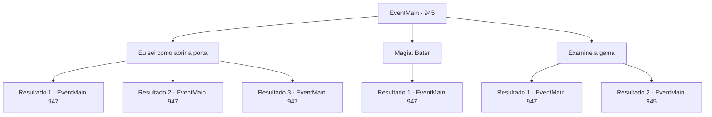

# Eventos principais · 945

[Índice da tabela](index.md) · [Índice geral](../index.md)

ID: `pt:EventMain:945` · Fonte: `EventMain4` · Versão: 1.2.47.

Mapeamento estático dos arquivos; a disponibilidade e a execução dependem do estado da run.

## Texto do evento

*Sem texto no arquivo.*

## Dados de entrada

```json
{
  "id": 945,
  "grade": 1,
  "normalGoal": "",
  "required": ""
}
```

## Mapa das escolhas



## Escolhas e resultados

### Escolha 1

Eu sei como abrir a porta

Requisitos e outros campos da escolha:

```json
{
  "required": ""
}
```

#### Resultado 1.1

Você soca a joia com seu punho, quebrando-a. Então, você coloca suas mãos dentro de onde a joia costumava estar, forçando a porta a se abrir. Um espaço amplo é revelado. |drawing_outerQueenTrue| Há um feixe de tentáculos de cor cinza claro que se parece com um cérebro enorme. Em sua superfície, algo brilhante está se movendo ao longo das veias sanguíneas, e sob isso, há inúmeros tentáculos com espinhos. A forma de uma bela dama está pendurada na parte inferior do enorme monte, assim como uma pituitária. Você, Rosilpha e Naverr se aproximam da Rainha. Assim que a Rainha vê Naverr, ela fala com um enorme senso de intimidação. 

 "Então, você conseguiu chegar até aqui."


Continuação registrada: [Evento 947](0947.md) na mesma tabela.

```json
{
  "required": "21_0_2",
  "chance": "1|0_5_1",
  "nextEvent": 947,
  "type": 0,
  "reward": ""
}
```

#### Resultado 1.2

Você soca a joia com o punho. Mas a joia é mais resistente do que você pensava. Ela não se quebra. 

 "Hm... Acho que sei para onde você está tentando ir com isso. Aqui, vamos tentar isso."

 Naverr pega seu facão e o balança na direção da joia. Inicialmente, a joia não se move, mas após algumas repetições ela eventualmente racha. Com a joia destruída, a porta se abre um pouco, revelando uma pequena abertura. Seu grupo força a porta aberta. |drawing_outerQueenTrue| Há um emaranhado de tentáculos de cor cinza claro que se parece com um cérebro enorme. Em sua superfície, algo brilhante está se movendo ao longo das veias sanguíneas, e abaixo disso, há inúmeros tentáculos com espinhos. A forma de uma bela dama está pendurada na parte inferior do enorme monte, assim como uma pituitária. Você, Rosilpha e Naverr se aproximam da Rainha. Assim que a Rainha vê Naverr, ela fala com um enorme senso de intimidação. 

 "Então, você conseguiu chegar até aqui."


Continuação registrada: [Evento 947](0947.md) na mesma tabela.

```json
{
  "required": "21_0_2",
  "chance": "20",
  "nextEvent": 947,
  "type": 1,
  "reward": ""
}
```

#### Resultado 1.3

Você sinaliza para Naverr e Rosilpha recuarem. Então, você cria uma bola de fogo em sua mão, lançando-a na porta. Com uma explosão feroz, um buraco gigante é feito onde a porta costumava estar. Um espaço amplo é revelado. |drawing_outerQueenTrue| Há um feixe de tentáculos de cor cinza claro que se parece com um cérebro enorme. Em sua superfície, algo brilhante está se movendo ao longo das veias sanguíneas, e sob isso, há inúmeros tentáculos com espinhos. A forma de uma bela dama está pendurada na parte inferior do enorme monte, assim como uma pituitária. Você, Rosilpha e Naverr se aproximam da Rainha. Assim que a Rainha vê Naverr, ela fala com um enorme senso de intimidação. 

 "Então, você conseguiu chegar até aqui."


Continuação registrada: [Evento 947](0947.md) na mesma tabela.

```json
{
  "required": "20_0_2",
  "chance": "1",
  "nextEvent": 947,
  "type": 2,
  "reward": ""
}
```

### Escolha 2

Magia: Bater

Requisitos e outros campos da escolha:

```json
{
  "required": "20_0_1"
}
```

#### Resultado 2.1

Você abre a porta com magia. Ao abrir a porta, um amplo espaço é revelado. |drawing_outerQueenTrue| Há um emaranhado de tentáculos de cor cinza claro que se parece com um cérebro enorme. Em sua superfície, algo brilhante está se movendo ao longo das veias sanguíneas, e sob isso, há inúmeros tentáculos com espinhos. A forma de uma bela dama está pendurada na parte inferior do enorme monte, assim como uma pituitária. Você, Rosilpha e Naverr se aproximam da Rainha. Assim que a Rainha vê Naverr, ela fala com um enorme senso de intimidação. 

 "Então, você conseguiu chegar até aqui."


Continuação registrada: [Evento 947](0947.md) na mesma tabela.

```json
{
  "required": "",
  "chance": "1",
  "nextEvent": 947,
  "type": 2,
  "reward": ""
}
```

### Escolha 3

Examine a gema

Requisitos e outros campos da escolha:

```json
{
  "required": "5_689_0"
}
```

#### Resultado 3.1

Você examina cuidadosamente a joia na porta. Ao redor da joia está gravado o que parece ser a linguagem dos devoradores de almas. Você consegue decifrá-lo. 'Toque a joia com sua mão. Então, comande a porta.' Seguindo as palavras, você estende a mão para a joia. Em seguida, você ordena mentalmente que a porta se abra. A joia começa a brilhar, e a porta se abre. Ao abrir a porta, um espaço amplo é revelado. |drawing_outerQueenTrue| Há um emaranhado de tentáculos de cor cinza claro que se parece com um cérebro enorme. Em sua superfície, algo brilhante está se movendo ao longo das veias sanguíneas, e abaixo disso, há inúmeros tentáculos com espinhos. A forma de uma bela dama está pendurada na parte inferior do enorme monte, como uma pituitária. Você, Rosilpha e Naverr se aproximam da Rainha. Assim que a Rainha vê Naverr, ela fala com um enorme senso de intimidação. 

 "Então, você conseguiu chegar até aqui."


Continuação registrada: [Evento 947](0947.md) na mesma tabela.

```json
{
  "required": "",
  "chance": "1|0_7_1",
  "nextEvent": 947,
  "type": 0,
  "reward": ""
}
```

#### Resultado 3.2

Você examina a joia na porta. Você nunca viu uma escrita como essa antes - não há chance de decifrá-la. Parece que você deve encontrar outro caminho.

Continuação registrada: [Evento 945](0945.md) na mesma tabela.

```json
{
  "required": "",
  "chance": "30",
  "nextEvent": 945,
  "type": 1,
  "reward": "5_689_1"
}
```

## Referências que chegam a este evento

- [Evento 944 · escolha 1 · resultado 1](0944.md#escolha-1)
- [Evento 944 · escolha 2 · resultado 1](0944.md#escolha-2)
- [Evento 945 · escolha 3 · resultado 2](0945.md#escolha-3)
