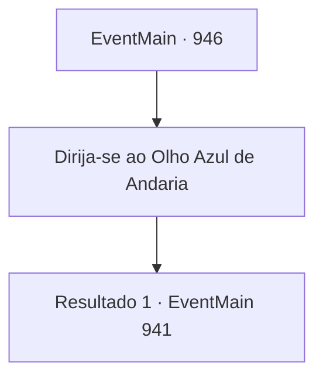

# Eventos principais · 946

[Índice da tabela](index.md) · [Índice geral](../index.md)

ID: `pt:EventMain:946` · Fonte: `EventMain4` · Versão: 1.2.47.

Mapeamento estático dos arquivos; a disponibilidade e a execução dependem do estado da run.

## Texto do evento

*Sem texto no arquivo.*

## Dados de entrada

```json
{
  "id": 946,
  "grade": 1,
  "normalGoal": "",
  "required": ""
}
```

## Mapa das escolhas



## Escolhas e resultados

### Escolha 1

Dirija-se ao Olho Azul de Andaria

Requisitos e outros campos da escolha:

```json
{
  "required": ""
}
```

#### Resultado 1.1

Você segue para o 'Olho Azul de Andaria' com seus aliados. Lá, você encontra o navio de batalha devoralmas. Perto do navio estão alguns devoradores de almas, segurando o Disco da Lua e fazendo algo. Naverr explica que eles estão tentando abrir o portal para o Plano Astral. A serpente de videira da árvore imediatamente sobe, mordendo o navio de batalha devoralmas. Em seguida, ele o enlaça com seu corpo e o joga no chão lamacento. 

 "Mate-os!"

 Ouvindo a ordem da Serpente Divina, os gripplis começam a avançar. A batalha contra os devoradores de almas começa. Então, Naverr se aproxima de você e fala. 

 "Agora é a chance de lidar com a Rainha."


Continuação registrada: [Evento 941](0941.md) na mesma tabela.

```json
{
  "required": "",
  "chance": "1",
  "nextEvent": 941,
  "type": 2,
  "reward": ""
}
```

## Referências que chegam a este evento

- [Evento 940 · escolha 1 · resultado 1](0940.md#escolha-1)
