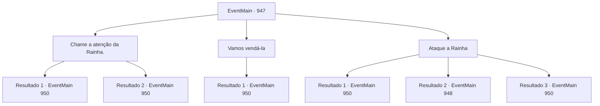

# Eventos principais · 947

[Índice da tabela](index.md) · [Índice geral](../index.md)

ID: `pt:EventMain:947` · Fonte: `EventMain4` · Versão: 1.2.47.

Mapeamento estático dos arquivos; a disponibilidade e a execução dependem do estado da run.

## Texto do evento

*Sem texto no arquivo.*

## Dados de entrada

```json
{
  "id": 947,
  "grade": 1,
  "normalGoal": "",
  "required": ""
}
```

## Mapa das escolhas



## Escolhas e resultados

### Escolha 1

Chame a atenção da Rainha.

Requisitos e outros campos da escolha:

```json
{
  "required": "5_688_1"
}
```

#### Resultado 1.1

Você consegue suportar a imensa pressão da Rainha, tentando uma conversa com ela. Ela te examina curiosamente de cima a baixo, e então fala. 

 "Hmm... Tudo bem. Vamos conversar, então."

 A Rainha diz que simplesmente não consegue entender por que você está tentando impedi-la. 

 "Você não vai me perturbar. Estou tentando libertar todos vocês."

 Você pede à Rainha uma explicação mais detalhada, mostrando sinais de interesse. Ela continua em um tom ligeiramente mais animado. 

 "Você precisa se libertar do ciclo chamado reencarnação. Somente assim você poderá se libertar da opressão dos Deuses."

 Absorvida em suas próprias palavras, a Rainha começa um discurso completo. Por fim, ela estende a mão para você, oferecendo que você se junte a ela. 

 "Junte-se a nós. Vamos acabar com isso..."

 Enquanto a Rainha está falando, a flecha de Rosilpha interrompe a conversa, se alojando nos ombros da Rainha. Seu corpo recua antes de retornar à posição original. 

 "Você... mal pode esperar para ser morto, não é."

 A batalha contra a Rainha começa.

Continuação registrada: [Evento 950](0950.md) na mesma tabela.

```json
{
  "required": "",
  "chance": "1|0_12_1",
  "nextEvent": 950,
  "type": 0,
  "reward": "6_2_171",
  "place": 15
}
```

#### Resultado 1.2

Você tenta conversar com a Rainha. No entanto, quando seus olhos dourados se conectam aos seus, seu corpo não se move. A Rainha se aproxima lentamente de você, falando. 

 "Não tenho intenção de te machucar. Muito pelo contrário - estou tentando te salvar. E ainda assim, você está tentando me pregar peças bobas."

 A Rainha levanta as mãos, disparando raios carmesins em Rosilpha e Naverr. Seu plano é frustrado. A batalha contra a Rainha começa.

Continuação registrada: [Evento 950](0950.md) na mesma tabela.

```json
{
  "required": "",
  "chance": "18",
  "nextEvent": 950,
  "type": 1,
  "reward": "6_0_171",
  "place": 15
}
```

### Escolha 2

Vamos vendá-la

Requisitos e outros campos da escolha:

```json
{
  "required": "5_686_1"
}
```

#### Resultado 2.1

Naverr tira o Cilindro de Flash de Neblina Mark-I de seus bolsos e joga para a Rainha. Com um brilho intenso, fumaça começa a encher a sala. 

 "ARRRRGH!! VOCÊ...!"

 A invenção de Naverr funciona surpreendentemente bem. A Rainha tenta proteger seus olhos, cambaleando. Começa a se debater com seus tentáculos.

Continuação registrada: [Evento 950](0950.md) na mesma tabela.

```json
{
  "required": "",
  "chance": "1",
  "nextEvent": 950,
  "type": 0,
  "reward": "6_2_171",
  "place": 15
}
```

### Escolha 3

Ataque a Rainha

Requisitos e outros campos da escolha:

```json
{
  "required": "5_687_1"
}
```

#### Resultado 3.1

Você consegue suportar a imensa pressão da Rainha, atacando-a imediatamente. Assim que percebe que sua dominação não está funcionando, ela balança seus tentáculos com pressa.

Continuação registrada: [Evento 950](0950.md) na mesma tabela.

```json
{
  "required": "24_7_1",
  "chance": "1|0_12_1",
  "nextEvent": 950,
  "type": 0,
  "reward": "6_0_171",
  "place": 15
}
```

#### Resultado 3.2

Você tenta atacar a Rainha, mas quando seus olhos dourados se conectam com os seus, seu corpo não se move. 

 "Lute por mim."

 Seguindo o comando da Rainha, seu corpo começa a atacar Naverr em vez disso. Enquanto isso, a Rainha está atacando Rosilpha com seus tentáculos.

Continuação registrada: [Evento 948](0948.md) na mesma tabela.

```json
{
  "required": "24_7_1",
  "chance": "30",
  "nextEvent": 948,
  "type": 1,
  "reward": "6_0_172",
  "place": 15
}
```

#### Resultado 3.3

Você consegue suportar a imensa pressão da Rainha, atacando-a imediatamente. Assim que percebe que sua dominação não está funcionando, ela balança seus tentáculos com pressa.

Continuação registrada: [Evento 950](0950.md) na mesma tabela.

```json
{
  "required": "23_7_1",
  "chance": "1",
  "nextEvent": 950,
  "type": 2,
  "reward": "6_0_171",
  "place": 15
}
```

## Referências que chegam a este evento

- [Evento 945 · escolha 1 · resultado 1](0945.md#escolha-1)
- [Evento 945 · escolha 1 · resultado 2](0945.md#escolha-1)
- [Evento 945 · escolha 1 · resultado 3](0945.md#escolha-1)
- [Evento 945 · escolha 2 · resultado 1](0945.md#escolha-2)
- [Evento 945 · escolha 3 · resultado 1](0945.md#escolha-3)
