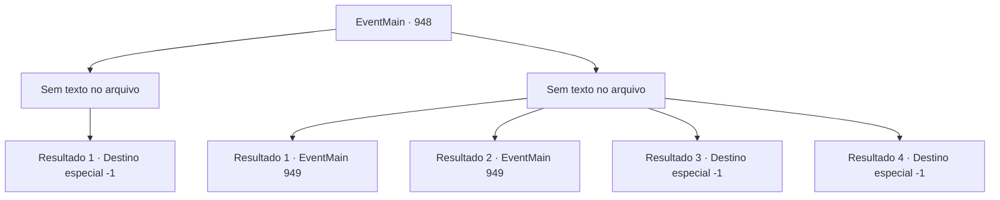

# Eventos principais · 948

[Índice da tabela](index.md) · [Índice geral](../index.md)

ID: `pt:EventMain:948` · Fonte: `EventMain4` · Versão: 1.2.47.

Mapeamento estático dos arquivos; a disponibilidade e a execução dependem do estado da run.

## Texto do evento

*Sem texto no arquivo.*

## Dados de entrada

```json
{
  "id": 948,
  "grade": 1,
  "normalGoal": "",
  "required": ""
}
```

## Mapa das escolhas



## Escolhas e resultados

### Escolha 1

*Sem texto no arquivo; o papel dessa opção depende da interface do jogo.*

Requisitos e outros campos da escolha:

```json
{
  "required": ""
}
```

#### Resultado 1.1

Quando Naverr percebe que a batalha não está indo bem, ele tira o cilindro de prata de seus bolsos. Ele então tenta jogá-lo para a Rainha, mas a Rainha é mais rápida. O braço decepado de Naverr é lançado ao ar, borrifando sangue no chão. Naverr grita de dor, desabando no chão. Logo, a Rainha perfura tanto Rosilpha quanto Naverr com seu raio carmesim. Pairando sobre os dois cadáveres, a Rainha se aproxima de você. 

 "Você provou ser digno. Alegre-se."

 Assim que termina de falar, sua boca se divide em cruzes, revelando os tentáculos brancos. Eles se enterram em seu nariz, boca e ouvidos em apenas um segundo. A súbita onda de dor o torna impotente para resistir. 

 "Agora você é um de nós."

 Assim, você perde sua mente e se torna um devoralmas.

Continuação registrada: [Destino especial `-1`](../destinos-especiais.md).

```json
{
  "required": "",
  "chance": "1",
  "nextEvent": -1,
  "type": 2,
  "reward": "15_6_1|15_6_2|15_6_21|25_8_1"
}
```

### Escolha 2

*Sem texto no arquivo; o papel dessa opção depende da interface do jogo.*

Requisitos e outros campos da escolha:

```json
{
  "required": ""
}
```

#### Resultado 2.1

O facão de Naverr perfura sua coxa. Uma dor vertiginosa se espalha pelo seu corpo enquanto você cai no chão. Mas graças à dor, você agora está livre do domínio da Rainha. 

 "Desculpe. Não havia outra maneira. A lâmina está envenenada com veneno de rã, então pode ser um pouco difícil se mover por um tempo."

 Ele diz enquanto remove a lâmina da sua coxa. 

 "A Serpente Divina nos ajudará em breve. Sem contar os gripplis da vila. Apenas aguente firme."

 Ele então volta direto para lutar contra a Rainha.

Continuação registrada: [Evento 949](0949.md) na mesma tabela.

```json
{
  "required": "1_0_2|1_1_2|21_15_1",
  "chance": "1",
  "nextEvent": 949,
  "type": 2,
  "reward": "0_6_-1|0_0_-1|0_1_-1"
}
```

#### Resultado 2.2

O facão de Naverr perfura sua coxa. Uma dor vertiginosa se espalha pelo seu corpo enquanto você cai no chão. Mas graças à dor, você agora está livre do domínio da Rainha. 

 "Desculpe. Não havia outra maneira. A lâmina está envenenada com veneno de rã, então pode ser um pouco difícil se mover por um tempo."

 Ele diz enquanto remove a lâmina da sua coxa. 

 "A Serpente Divina nos ajudará em breve. Sem contar os gripplis da vila. Apenas aguente firme."

 Ele então volta direto para lutar contra a Rainha.

Continuação registrada: [Evento 949](0949.md) na mesma tabela.

```json
{
  "required": "1_0_2|1_1_2|20_15_1",
  "chance": "1",
  "nextEvent": 949,
  "type": 2,
  "reward": "0_0_-1|0_1_-1"
}
```

#### Resultado 2.3

O facão de Naverr perfura sua coxa. Uma dor vertiginosa se espalha pelo seu corpo enquanto você cai no chão. Mas graças à dor, você agora está livre do domínio da Rainha. 

 "Desculpe. Não havia outra maneira. A lâmina está envenenada com veneno de rã, então pode ser um pouco difícil se mover por um tempo."

 Ele diz enquanto remove a lâmina da sua coxa. 

 "A Serpente Divina nos ajudará em breve. Sem contar os gripplis da vila. Apenas aguente firme."

 Ele então volta direto para lutar contra a Rainha. Mas você não consegue fazer o mesmo. Seu corpo já atingiu seu limite. Infelizmente, seus olhos se fecham, desta vez para sempre.

Continuação registrada: [Destino especial `-1`](../destinos-especiais.md).

```json
{
  "required": "2_0_2",
  "chance": "1",
  "nextEvent": -1,
  "type": 2,
  "reward": "15_6_21|15_6_1|25_8_1|0_0_-1|0_1_-1"
}
```

#### Resultado 2.4

O facão de Naverr perfura sua coxa. Uma dor vertiginosa se espalha pelo seu corpo enquanto você cai no chão. Mas graças à dor, você agora está livre do domínio da Rainha. 

 "Desculpe. Não havia outra maneira. A lâmina está envenenada com veneno de rã, então pode ser um pouco difícil se mover por um tempo."

 Ele diz enquanto remove a lâmina da sua coxa. 

 "A Serpente Divina nos ajudará em breve. Sem contar os gripplis da vila. Apenas aguente firme."

 Ele então volta direto para lutar contra a Rainha. Mas você não consegue fazer o mesmo. Seu corpo já atingiu seu limite. Infelizmente, seus olhos se fecham, desta vez para sempre.

Continuação registrada: [Destino especial `-1`](../destinos-especiais.md).

```json
{
  "required": "2_1_2",
  "chance": "1",
  "nextEvent": -1,
  "type": 2,
  "reward": "15_6_21|15_6_1|25_8_1|0_0_-1|0_1_-1"
}
```

## Referências que chegam a este evento

- [Evento 947 · escolha 3 · resultado 2](0947.md#escolha-3)
