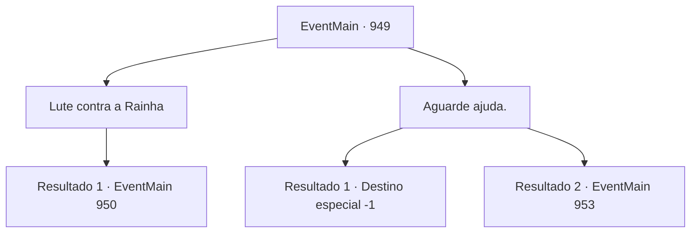

# Eventos principais · 949

[Índice da tabela](index.md) · [Índice geral](../index.md)

ID: `pt:EventMain:949` · Fonte: `EventMain4` · Versão: 1.2.47.

Mapeamento estático dos arquivos; a disponibilidade e a execução dependem do estado da run.

## Texto do evento

*Sem texto no arquivo.*

## Dados de entrada

```json
{
  "id": 949,
  "grade": 1,
  "normalGoal": "",
  "required": ""
}
```

## Mapa das escolhas



## Escolhas e resultados

### Escolha 1

Lute contra a Rainha

Requisitos e outros campos da escolha:

```json
{
  "required": ""
}
```

#### Resultado 1.1

Você rapidamente enfaixa o ferimento, tentando parar o sangramento. Seu coração dispara, e seu corpo treme. Mas com determinação, você se levanta novamente. Você volta a lutar contra a Rainha com Rosilpha e Naverr.

Continuação registrada: [Evento 950](0950.md) na mesma tabela.

```json
{
  "required": "",
  "chance": "1",
  "nextEvent": 950,
  "type": 2,
  "reward": "6_0_171",
  "place": 15
}
```

### Escolha 2

Aguarde ajuda.

Requisitos e outros campos da escolha:

```json
{
  "required": ""
}
```

#### Resultado 2.1

Você fica no chão, esperando pelo avatar e pelos gripplis. Logo, Naverr cai. A Rainha agarra seu corpo com seus tentáculos, usando-o como escudo contra as flechas de Rosilpha. 

 "V-VOCÊ COVARDE!"

 Rosilpha então percebe que não tem mais flechas em sua aljava. Ele pega sua adaga e avança furiosamente contra a Rainha. Mas não termina bem. O raio carmesim da Rainha perfura Rosilpha. Assim que ele cai no chão, a Rainha vira seus olhos para você. 

 "Você... Eu sei o que fazer com você. Alegre-se."

 Assim que termina de falar, sua boca se divide em cruzes, revelando os tentáculos brancos. Eles se enterram em seu nariz, boca e ouvidos em apenas um segundo. A súbita onda de dor o torna impotente para resistir. 

 "Agora você é um de nós."

 Assim, você perde sua mente e se torna um devoralmas.

Continuação registrada: [Destino especial `-1`](../destinos-especiais.md).

```json
{
  "required": "",
  "chance": "9",
  "nextEvent": -1,
  "type": 2,
  "reward": "15_6_1|15_6_2|15_6_21|25_8_1"
}
```

#### Resultado 2.2

Você fica no chão, esperando pelo avatar e pelos gripplis. Enquanto isso, Naverr desvia dos ataques da Rainha, o cilindro prateado cai de seus bolsos e entra em contato com uma das flechas de Rosilpha. Uma explosão acontece. Um flash brilhante, um barulho alto e uma fumaça espessa enchem a sala. 

 "ARRRRGH!! VOCÊ...!"

 A invenção de Naverr funciona surpreendentemente bem. A Rainha tenta proteger os olhos, cambaleando. Começa a se debater com seus tentáculos. Rosilpha percebe que não tem mais flechas. Ele larga imediatamente seu arco, pega sua adaga e avança contra a Rainha. Então, o navio começa a tremer, o que faz Rosilpha cair. Com o impulso adicional, Rosilpha voa em direção à Rainha, cravando a adaga em seu corpo. 

 "*tosse*.... UGGH...!"

 Uma necrose negra começa a se espalhar a partir do ferimento, e a Rainha logo se desfaz em nada. Rosilpha e Naverr ficam ali, perplexos. 

 "É isso...?"

 "Acho que sim."


Continuação registrada: [Evento 953](0953.md) na mesma tabela.

```json
{
  "required": "",
  "chance": "1",
  "nextEvent": 953,
  "type": 2,
  "reward": ""
}
```

## Referências que chegam a este evento

- [Evento 948 · escolha 2 · resultado 1](0948.md#escolha-2)
- [Evento 948 · escolha 2 · resultado 2](0948.md#escolha-2)
