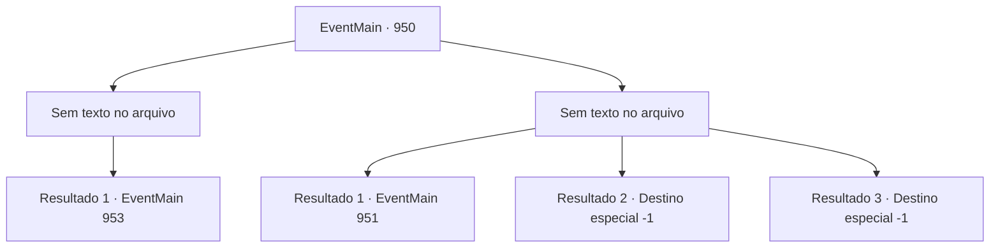

# Eventos principais · 950

[Índice da tabela](index.md) · [Índice geral](../index.md)

ID: `pt:EventMain:950` · Fonte: `EventMain4` · Versão: 1.2.47.

Mapeamento estático dos arquivos; a disponibilidade e a execução dependem do estado da run.

## Texto do evento

*Sem texto no arquivo.*

## Dados de entrada

```json
{
  "id": 950,
  "grade": 1,
  "normalGoal": "",
  "required": ""
}
```

## Mapa das escolhas



## Escolhas e resultados

### Escolha 1

*Sem texto no arquivo; o papel dessa opção depende da interface do jogo.*

Requisitos e outros campos da escolha:

```json
{
  "required": ""
}
```

#### Resultado 1.1

Naverr e Rosilpha são jogados no chão pelos ataques da Rainha. Mas você aproveita a oportunidade, desferindo o golpe final na Rainha. Ela se agarra a você em seus estertores de morte. 

 "Eu... Eu não vou morrer assim..!"

 Então seu rosto se divide em cruzes, tentáculos brancos se esticam dela. Mas você sacode a Rainha e esmaga sua cabeça no chão. Seu movimento para. 

 "É isso...?"

 "Acho que sim."


Continuação registrada: [Evento 953](0953.md) na mesma tabela.

```json
{
  "required": "",
  "chance": "1",
  "nextEvent": 953,
  "type": 2,
  "reward": ""
}
```

### Escolha 2

*Sem texto no arquivo; o papel dessa opção depende da interface do jogo.*

Requisitos e outros campos da escolha:

```json
{
  "required": ""
}
```

#### Resultado 2.1

Naverr e Rosilpha são jogados ao chão pelos ataques da Rainha. Você encontra o mesmo destino. Embora incerto, você sente uma dor extrema como se algum osso estivesse quebrado. Então, o casco do navio se abre, enquanto a grande cabeça da serpente de videira da árvore se choca. Ela então começa a lutar contra a Rainha. O raio carmesim destrói as vinhas, enquanto o veneno da serpente dissolve os tentáculos da Rainha.

Continuação registrada: [Evento 951](0951.md) na mesma tabela.

```json
{
  "required": "1_0_2|1_1_2",
  "chance": "1",
  "nextEvent": 951,
  "type": 2,
  "reward": ""
}
```

#### Resultado 2.2

Você é jogado ao chão pelos ataques da Rainha. Embora incerto, você sente uma dor extrema como se algum osso estivesse quebrado em algum lugar. Então, o casco do navio se abre. Os destroços caídos caem em cima de você.

Continuação registrada: [Destino especial `-1`](../destinos-especiais.md).

```json
{
  "required": "2_0_2",
  "chance": "1",
  "nextEvent": -1,
  "type": 2,
  "reward": "15_6_1|15_6_17|25_8_1"
}
```

#### Resultado 2.3

Você é jogado ao chão pelos ataques da Rainha. Embora incerto, você sente uma dor extrema como se algum osso estivesse quebrado em algum lugar. Então, o casco do navio se abre. Os destroços caídos caem em cima de você.

Continuação registrada: [Destino especial `-1`](../destinos-especiais.md).

```json
{
  "required": "2_1_2",
  "chance": "1",
  "nextEvent": -1,
  "type": 2,
  "reward": "15_6_1|15_6_17|25_8_1"
}
```

## Referências que chegam a este evento

- [Evento 947 · escolha 1 · resultado 1](0947.md#escolha-1)
- [Evento 947 · escolha 1 · resultado 2](0947.md#escolha-1)
- [Evento 947 · escolha 2 · resultado 1](0947.md#escolha-2)
- [Evento 947 · escolha 3 · resultado 1](0947.md#escolha-3)
- [Evento 947 · escolha 3 · resultado 3](0947.md#escolha-3)
- [Evento 949 · escolha 1 · resultado 1](0949.md#escolha-1)
