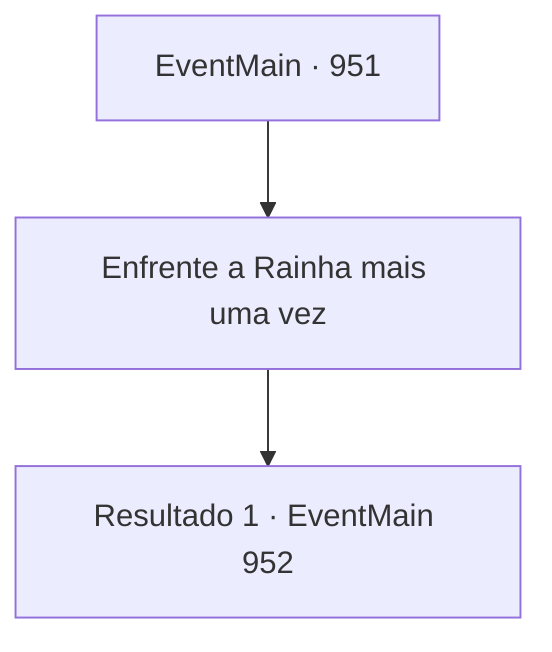

# Eventos principais · 951

[Índice da tabela](index.md) · [Índice geral](../index.md)

ID: `pt:EventMain:951` · Fonte: `EventMain4` · Versão: 1.2.47.

Mapeamento estático dos arquivos; a disponibilidade e a execução dependem do estado da run.

## Texto do evento

*Sem texto no arquivo.*

## Dados de entrada

```json
{
  "id": 951,
  "grade": 1,
  "normalGoal": "",
  "required": ""
}
```

## Mapa das escolhas



## Escolhas e resultados

### Escolha 1

Enfrente a Rainha mais uma vez

Requisitos e outros campos da escolha:

```json
{
  "required": ""
}
```

#### Resultado 1.1

Você se levanta mais uma vez. Então, você retorna à luta contra a Rainha, ajudando o avatar da Serpente Divina.

Continuação registrada: [Evento 952](0952.md) na mesma tabela.

```json
{
  "required": "",
  "chance": "1",
  "nextEvent": 952,
  "type": 2,
  "reward": "6_2_171",
  "place": 15
}
```

## Referências que chegam a este evento

- [Evento 950 · escolha 2 · resultado 1](0950.md#escolha-2)
