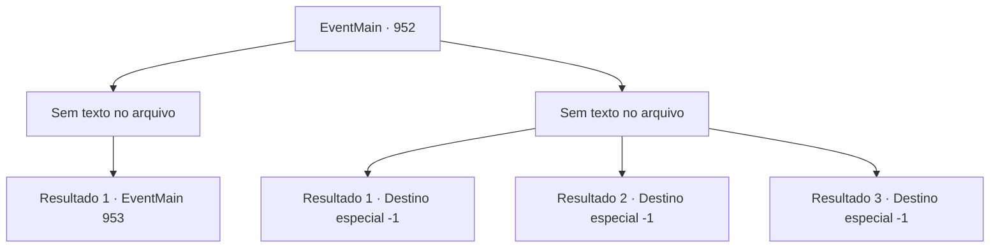

# Eventos principais · 952

[Índice da tabela](index.md) · [Índice geral](../index.md)

ID: `pt:EventMain:952` · Fonte: `EventMain4` · Versão: 1.2.47.

Mapeamento estático dos arquivos; a disponibilidade e a execução dependem do estado da run.

## Texto do evento

*Sem texto no arquivo.*

## Dados de entrada

```json
{
  "id": 952,
  "grade": 1,
  "normalGoal": "",
  "required": ""
}
```

## Mapa das escolhas



## Escolhas e resultados

### Escolha 1

*Sem texto no arquivo; o papel dessa opção depende da interface do jogo.*

Requisitos e outros campos da escolha:

```json
{
  "required": ""
}
```

#### Resultado 1.1

Você e o avatar da Serpente Divina derrubam a Rainha. 

 "Eu... Eu não vou morrer assim...!"

 A Rainha luta desesperadamente, mas você não tem intenção de deixar pontas soltas. Você termina rapidamente.

Continuação registrada: [Evento 953](0953.md) na mesma tabela.

```json
{
  "required": "",
  "chance": "1",
  "nextEvent": 953,
  "type": 2,
  "reward": ""
}
```

### Escolha 2

*Sem texto no arquivo; o papel dessa opção depende da interface do jogo.*

Requisitos e outros campos da escolha:

```json
{
  "required": ""
}
```

#### Resultado 2.1

A Rainha reflete seu ataque, então foge pelo buraco. O avatar tenta agarrar a Rainha com suas vinhas, mas os outros devoradores de almas se jogam nas vinhas para bloqueá-las. 

 "...Ela fugiu. Mas isso não é o fim. Ela simplesmente se esconderá e, quando for a hora certa, voltará a este lugar com poder suficiente."

 A serpente de videira da árvore continua, olhando para você. 

 "A luta ainda não acabou. Mas bom trabalho. Você nos ajudou a proteger esta selva. Eu te concederei minha bênção."

 Seu grupo se ajuda a se levantar, então sai da nave devoradora de almas. A batalha do lado de fora também acabou. <link=shake>

 "*coaxar* *coaxar* *coaxar*!!"

</link> O som de sapos ecoa pelo lugar. Deve ser assim que os gripplis celebram a vitória.

Continuação registrada: [Destino especial `-1`](../destinos-especiais.md).

```json
{
  "required": "1_0_2|1_1_2",
  "chance": "1",
  "nextEvent": -1,
  "type": 2,
  "reward": "15_6_1|15_6_17|15_6_24"
}
```

#### Resultado 2.2

O raio carmesim da Rainha te atinge diretamente. Um buraco gigante aparece em seu peito, e você nem sente a dor. Por fim, você encontra o seu fim.

Continuação registrada: [Destino especial `-1`](../destinos-especiais.md).

```json
{
  "required": "2_0_2",
  "chance": "1",
  "nextEvent": -1,
  "type": 2,
  "reward": "15_6_1|15_6_21|25_8_1"
}
```

#### Resultado 2.3

O raio carmesim da Rainha te atinge diretamente. Um buraco gigante aparece em seu peito, e você nem sente a dor. Por fim, você encontra o seu fim.

Continuação registrada: [Destino especial `-1`](../destinos-especiais.md).

```json
{
  "required": "2_1_2",
  "chance": "1",
  "nextEvent": -1,
  "type": 2,
  "reward": "15_6_1|15_6_21|25_8_1"
}
```

## Referências que chegam a este evento

- [Evento 951 · escolha 1 · resultado 1](0951.md#escolha-1)
