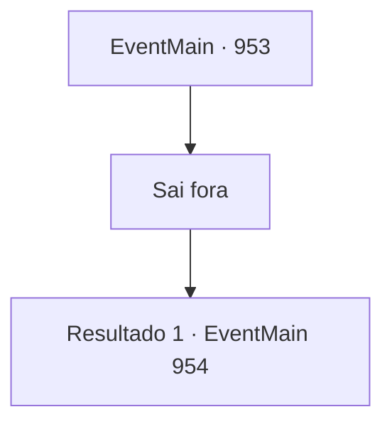

# Eventos principais · 953

[Índice da tabela](index.md) · [Índice geral](../index.md)

ID: `pt:EventMain:953` · Fonte: `EventMain4` · Versão: 1.2.47.

Mapeamento estático dos arquivos; a disponibilidade e a execução dependem do estado da run.

## Texto do evento

*Sem texto no arquivo.*

## Dados de entrada

```json
{
  "id": 953,
  "grade": 1,
  "normalGoal": "",
  "required": ""
}
```

## Mapa das escolhas



## Escolhas e resultados

### Escolha 1

Sai fora

Requisitos e outros campos da escolha:

```json
{
  "required": ""
}
```

#### Resultado 1.1

Sua festa se ajuda mutuamente, então deixam o navio devoralmas. A batalha lá fora também acabou. O som de sapos ecoa pelo lugar. <link=shake>

 "*coaxar* *coaxar* *coaxar*!!"

</link> Deve ser assim que os gripplis celebram a vitória. Então, a serpente de videira se aproxima de você. A voz da Serpente Divina flui dela. 

 "Ambos desempenharam um papel importante na proteção da selva. Diga, tenho uma oferta a fazer. Você estaria disposto a se tornar um campeão de Andaria?"

 Ao ouvir isso, Rosilpha pula de excitação. 

 "S- sério?!"

 Então o ancião cutuca suas costelas com o cotovelo. Quando o ancião lhe dá uma dica, Rosilpha suprime sua alegria e se ajoelha em sua perna. 

 "Se você me conceder tal posição, farei o meu melhor para cumprir meu dever."

 Naverr olha para você cuidadosamente e fala. 

 "... A decisão é sua afinal, mas eu pessoalmente preferiria que você permanecesse um estudioso."


Continuação registrada: [Evento 954](0954.md) na mesma tabela.

```json
{
  "required": "",
  "chance": "1",
  "nextEvent": 954,
  "type": 2,
  "reward": ""
}
```

## Referências que chegam a este evento

- [Evento 949 · escolha 2 · resultado 2](0949.md#escolha-2)
- [Evento 950 · escolha 1 · resultado 1](0950.md#escolha-1)
- [Evento 952 · escolha 1 · resultado 1](0952.md#escolha-1)
