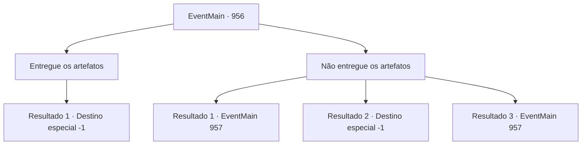

# Eventos principais · 956

[Índice da tabela](index.md) · [Índice geral](../index.md)

ID: `pt:EventMain:956` · Fonte: `EventMain4` · Versão: 1.2.47.

Mapeamento estático dos arquivos; a disponibilidade e a execução dependem do estado da run.

## Texto do evento

*Sem texto no arquivo.*

## Dados de entrada

```json
{
  "id": 956,
  "grade": 1,
  "normalGoal": "",
  "required": ""
}
```

## Mapa das escolhas



## Escolhas e resultados

### Escolha 1

Entregue os artefatos

Requisitos e outros campos da escolha:

```json
{
  "required": ""
}
```

#### Resultado 1.1

Tendo perdido a vontade de lutar, você decide entregar os artefatos. Naverr e Rosilpha tentam impedi-lo, mas não são rápidos o suficiente. Você se aproxima da Rainha e apresenta os artefatos. Com seu objetivo cumprido, a Rainha sorri gentilmente enquanto abraça suas mãos. 

 "Fufu... Uma escolha sábia, {1}. Eu lhe darei a honra de se tornar um de nós."

 Assim que termina de falar, sua boca se divide em cruzes, revelando os tentáculos brancos. Eles se enterram em seu nariz, boca e ouvidos em apenas um segundo. A súbita onda de dor o deixa impotente para resistir. 

 "Pronto. Agora você é um de nós."

 Assim, você perde sua mente e se torna um devoralmas.

Continuação registrada: [Destino especial `-1`](../destinos-especiais.md).

```json
{
  "required": "",
  "chance": "1",
  "nextEvent": -1,
  "type": 2,
  "reward": "4_315_1|4_316_1|15_6_4|25_8_1|15_6_0"
}
```

### Escolha 2

Não entregue os artefatos

Requisitos e outros campos da escolha:

```json
{
  "required": ""
}
```

#### Resultado 2.1

Você responde que não simplesmente entregará os artefatos. A rainha franze a testa, e então ordena os devoradores de almas. Seguindo sua ordem, os devoradores de almas começam seu ataque. Rosilpha luta rapidamente com seu arco, mas não consegue segurar todos eles. Naverr rapidamente agarra você pelos ombros e exclama. 

 "Isso não vai dar certo! Devemos nos separar. Um time vai ganhar tempo aqui, e o outro deve ir para o Vault Subterrâneo e selar os artefatos!"

 Não há muito tempo para ponderar. Você sente o forte aperto de Naverr em você, como se estivesse te instigando a fazer uma escolha.

Continuação registrada: [Evento 957](0957.md) na mesma tabela.

```json
{
  "required": "24_7_1",
  "chance": "1|0_12_1",
  "nextEvent": 957,
  "type": 0,
  "reward": ""
}
```

#### Resultado 2.2

Você falha em desafiar o comando da Rainha. Você não é mais o dono do seu corpo - você se aproxima da Rainha e entrega os artefatos. Naverr e Rosilpha tentam impedi-lo, mas não são rápidos o suficiente. Você se aproxima da Rainha e apresenta os artefatos. Com seu objetivo cumprido, a Rainha sorri gentilmente enquanto abraça suas mãos. 

 "Fufu... Uma escolha sábia, {1}. Eu lhe darei a honra de se tornar um de nós."

 Assim que termina de falar, sua boca se divide em cruzes, revelando os tentáculos brancos. Eles se enterram em seu nariz, boca e ouvidos em apenas um segundo. A súbita onda de dor o deixa impotente para resistir. 

 "Agora você é um de nós."

 Assim, você perde sua mente e se torna um devoralmas.

Continuação registrada: [Destino especial `-1`](../destinos-especiais.md).

```json
{
  "required": "24_7_1",
  "chance": "30",
  "nextEvent": -1,
  "type": 1,
  "reward": "15_6_4|25_8_1|15_6_0"
}
```

#### Resultado 2.3

Você responde que não simplesmente entregará os artefatos. A rainha franze a testa, e então ordena os devoradores de almas. Seguindo sua ordem, os devoradores de almas começam seu ataque. Rosilpha luta rapidamente com seu arco, mas não consegue segurar todos eles. Naverr rapidamente agarra você pelos ombros e exclama. 

 "Isso não vai dar certo! Devemos nos separar. Um time vai ganhar tempo aqui, e o outro deve ir para o Vault Subterrâneo e selar os artefatos!"

 Não há muito tempo para ponderar. Você sente o forte aperto de Naverr em você, como se estivesse te instigando a fazer uma escolha.

Continuação registrada: [Evento 957](0957.md) na mesma tabela.

```json
{
  "required": "23_7_1",
  "chance": "1",
  "nextEvent": 957,
  "type": 2,
  "reward": ""
}
```

## Referências que chegam a este evento

- [Evento 955 · escolha 3 · resultado 1](0955.md#escolha-3)
