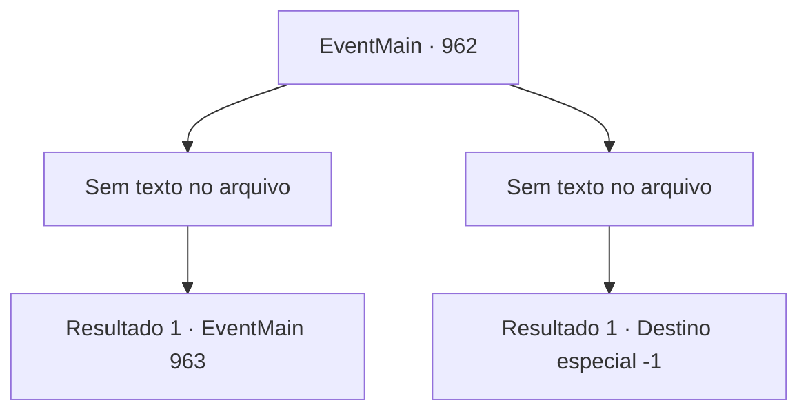

# Eventos principais · 962

[Índice da tabela](index.md) · [Índice geral](../index.md)

ID: `pt:EventMain:962` · Fonte: `EventMain4` · Versão: 1.2.47.

Mapeamento estático dos arquivos; a disponibilidade e a execução dependem do estado da run.

## Texto do evento

*Sem texto no arquivo.*

## Dados de entrada

```json
{
  "id": 962,
  "grade": 1,
  "normalGoal": "",
  "required": ""
}
```

## Mapa das escolhas



## Escolhas e resultados

### Escolha 1

*Sem texto no arquivo; o papel dessa opção depende da interface do jogo.*

Requisitos e outros campos da escolha:

```json
{
  "required": ""
}
```

#### Resultado 1.1

Com uma habilidade de combate surpreendente, você derrota a onda de devoradores de almas. Eles podem te sobrecarregar em número, mas o espaço estreito dificulta que eles utilizem isso. Então, a Rainha aparece por trás deles. Ela diz com uma voz fria enquanto olha para os corpos dos devoradores de almas debaixo de você. 

 "Vejo que você não é tão fraco quanto os outros. Eu irei te finalizar com minhas próprias mãos."|drawing_outerQueenTrue| A Rainha se abre, revelando sua verdadeira forma. Há um emaranhado de tentáculos de cor cinza claro que se parecem com um cérebro gigante. Em sua superfície, algo brilhante está se movendo ao longo das veias sanguíneas, e abaixo disso, há inúmeros tentáculos com espinhos. A forma de uma bela dama está pendurada na parte inferior do enorme monte, como uma pituitária. A Rainha começa a atacar, agitando seus tentáculos em sua direção.

Continuação registrada: [Evento 963](0963.md) na mesma tabela.

```json
{
  "required": "",
  "chance": "1",
  "nextEvent": 963,
  "type": 2,
  "reward": "6_0_171",
  "place": 7
}
```

### Escolha 2

*Sem texto no arquivo; o papel dessa opção depende da interface do jogo.*

Requisitos e outros campos da escolha:

```json
{
  "required": ""
}
```

#### Resultado 2.1

Sua luta desesperada é inútil contra o exército de devoradores de almas. Ai de você, é sufocado até a morte, enquanto os tentáculos o enredam em todas as partes do seu corpo. Em meio à consciência desvanecente, você percebe o que parece ser o último suspiro do Diretor.

Continuação registrada: [Destino especial `-1`](../destinos-especiais.md).

```json
{
  "required": "",
  "chance": "1",
  "nextEvent": -1,
  "type": 2,
  "reward": "25_8_1|15_6_0"
}
```

## Referências que chegam a este evento

- [Evento 961 · escolha 1 · resultado 1](0961.md#escolha-1)
- [Evento 961 · escolha 2 · resultado 2](0961.md#escolha-2)
