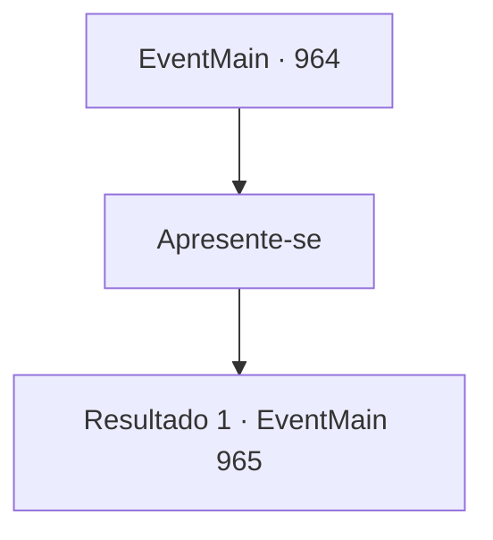

# Eventos principais · 964

[Índice da tabela](index.md) · [Índice geral](../index.md)

ID: `pt:EventMain:964` · Fonte: `EventMain4` · Versão: 1.2.47.

Mapeamento estático dos arquivos; a disponibilidade e a execução dependem do estado da run.

## Texto do evento

Você encontra o grupo de aventureiros que a família de Naverr contratou, perto da cidade de Sinias. Eles são um grupo de três: um anão de meia-idade, vestido com uma armadura pesada e um escudo, uma mulher humana levemente armada, e um meio-elfo que usa uma túnica. Eles te olham desconfiados enquanto você se aproxima deles. 

 "...Quem é você?"


## Dados de entrada

```json
{
  "id": 964,
  "grade": 1,
  "normalGoal": "",
  "required": "13_5_4|1_2_75"
}
```

## Mapa das escolhas



## Escolhas e resultados

### Escolha 1

Apresente-se

Requisitos e outros campos da escolha:

```json
{
  "required": ""
}
```

#### Resultado 1.1

Você se apresenta como aprendiz de Naverr. Eles te dão as boas-vindas, então se apresentam. O anão de meia-idade é 'Lodor', a humana é 'Lana' e o halfling é 'Charlie'. 

 "Ah, sim. Nós ouvimos falar de você pelo nosso empregador. Com certeza, poderíamos usar sua ajuda."

 Os aventureiros decidem modificar seu plano, com você fazendo parte dele. Eles já fizeram uma exploração adiante e sabem onde Naverr está. Lana coloca o dedo no mapa enquanto fala. 

 "Aqui. Naverr deve estar dentro deste prédio estranho. O local está fortemente guardado por mercenários armados."

 Charlie sugere que eles elaborem uma operação de distração, depois que ele usar sua magia para reunir visão. 

 "Vamos dividir isso em duas equipes. Uma irá distrair os guardas, enquanto a outra entra e resgata Naverr. Qual parte você vai assumir?"


Continuação registrada: [Evento 965](0965.md) na mesma tabela.

```json
{
  "required": "",
  "chance": "1",
  "nextEvent": 965,
  "type": 2,
  "reward": ""
}
```

## Referências que chegam a este evento

Nenhum `nextEvent` positivo da mesma tabela aponta para este nó. Isso não prova que seja inacessível: sorteio e estado de história podem selecioná-lo.

