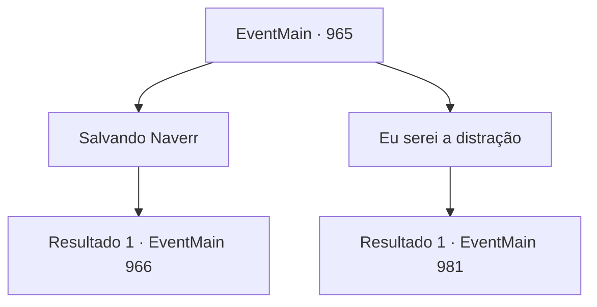

# Eventos principais · 965

[Índice da tabela](index.md) · [Índice geral](../index.md)

ID: `pt:EventMain:965` · Fonte: `EventMain4` · Versão: 1.2.47.

Mapeamento estático dos arquivos; a disponibilidade e a execução dependem do estado da run.

## Texto do evento

*Sem texto no arquivo.*

## Dados de entrada

```json
{
  "id": 965,
  "grade": 1,
  "normalGoal": "",
  "required": ""
}
```

## Mapa das escolhas



## Escolhas e resultados

### Escolha 1

Salvando Naverr

Requisitos e outros campos da escolha:

```json
{
  "required": ""
}
```

#### Resultado 1.1

Você decide entrar no prédio sozinho, para resgatar Naverr. 

 "Você está comigo, então."

 Charlie, o mago halfling, concorda em acompanhá-lo. Isso deixa Lana e Lodor como equipe de distração. 

 Você os segue até uma colina, de onde é possível ver todo o local onde Naverr está sendo mantido. Lana e Lodor descem a colina, enquanto Charlie invoca um familiar para investigar o interior do prédio. O familiar rato consegue entrar sem chamar atenção. Compartilhando a visão do familiar, Charlie explica o que está vendo. 

 "Aquilo... não é um prédio. Não tenho certeza do que é, mas parece ser as entranhas de algum tipo de... criatura. Naverr está trancado no porão. Precisamos contornar, ir para trás."

 Charlie sinaliza para Lana e Lodor. Eles se aproximam dos mercenários. Charlie então se vira para você e fala. 

 "Vá. Preciso me concentrar no meu feitiço."

 Você se dirige para a parte de trás do prédio, enquanto Lana e Lodor estão causando uma distração. Você encontra uma porta que parece levar ao porão. Um mercenário está guardando a porta.

Continuação registrada: [Evento 966](0966.md) na mesma tabela.

```json
{
  "required": "",
  "chance": "1",
  "nextEvent": 966,
  "type": 2,
  "reward": ""
}
```

### Escolha 2

Eu serei a distração

Requisitos e outros campos da escolha:

```json
{
  "required": ""
}
```

#### Resultado 2.1

Você decide distrair os mercenários. 

 "Tudo bem. Você está comigo, então."

 Lodor, o anão fortemente armado, decide ir com você. Isso deixa Lana e Charlie para a equipe de extração. 

 Você os segue até uma colina, de onde é possível ver todo o local onde Naverr está sendo mantido. Lana e Charlie começam a procurar uma maneira de entrar, enquanto você e Lodor descem a colina. Depois de alguns minutos, Charlie dá um sinal. 

 "Vamos."

 Você e Lodor se aproximam dos mercenários que guardam o prédio. Sem dizer nada, o guarda responde atacando você com sua lança.

Continuação registrada: [Evento 981](0981.md) na mesma tabela.

```json
{
  "required": "",
  "chance": "1",
  "nextEvent": 981,
  "type": 2,
  "reward": "6_0_91",
  "place": 4
}
```

## Referências que chegam a este evento

- [Evento 964 · escolha 1 · resultado 1](0964.md#escolha-1)
