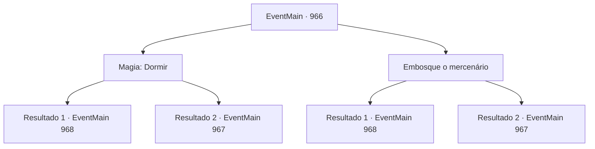

# Eventos principais · 966

[Índice da tabela](index.md) · [Índice geral](../index.md)

ID: `pt:EventMain:966` · Fonte: `EventMain4` · Versão: 1.2.47.

Mapeamento estático dos arquivos; a disponibilidade e a execução dependem do estado da run.

## Texto do evento

*Sem texto no arquivo.*

## Dados de entrada

```json
{
  "id": 966,
  "grade": 1,
  "normalGoal": "",
  "required": ""
}
```

## Mapa das escolhas



## Escolhas e resultados

### Escolha 1

Magia: Dormir

Requisitos e outros campos da escolha:

```json
{
  "required": "20_0_1|1_1_2"
}
```

#### Resultado 1.1

Você magicamente faz o mercenário dormir. Então, a aparência do mercenário desaparece, revelando sua verdadeira forma. É uma criatura que você nunca viu antes. Sua pele é roxa, e há tentáculos semelhantes a lulas pendurados em seu rosto. Você imediatamente o elimina e abre a porta para o porão. Como Charlie disse, o interior do prédio parece partes de um ser vivo, composto de tecido orgânico. Você encontra Naverr, trancado lá dentro. Julgando pelo estado em que ele se encontra, você assume que ele foi torturado. Naverr te encontra e seus olhos se arregalam. |drawing_naverrFace| 

 "O que...? Como você fez isso-"

 Mas ele não consegue se aproximar. Há um campo de força invisível, agindo como uma gaiola, impedindo Naverr de escapar. Examinando o campo de força, você encontra alguns símbolos exóticos. Segundo Naverr, os devoradores de almas interagiram com os símbolos para abrir e fechar a gaiola.

Continuação registrada: [Evento 968](0968.md) na mesma tabela.

```json
{
  "required": "",
  "chance": "1|0_7_1|0_12_1",
  "nextEvent": 968,
  "type": 0,
  "reward": "0_1_-1|0_2_1"
}
```

#### Resultado 1.2

Você tenta colocar o mercenário para dormir magicamente. Mas ele consegue resistir ao seu feitiço, tornando-o impotente. Ele rastreia a fonte da magia e te encontra. Imediatamente, sua forma começa a mudar. É uma criatura que você nunca viu antes. Sua pele é roxa, e há tentáculos semelhantes a lulas pendurados em seu rosto.

Continuação registrada: [Evento 967](0967.md) na mesma tabela.

```json
{
  "required": "",
  "chance": "24",
  "nextEvent": 967,
  "type": 1,
  "reward": "6_4_169|0_1_-1",
  "place": 4
}
```

### Escolha 2

Embosque o mercenário

Requisitos e outros campos da escolha:

```json
{
  "required": ""
}
```

#### Resultado 2.1

Você se aproxima silenciosamente do mercenário e quebra o pescoço dele. A aparência do mercenário se desfaz conforme sua vida é tirada. É uma criatura que você nunca viu antes. Sua pele é roxa, e há tentáculos semelhantes a lulas pendurados em seu rosto. Você abre a porta do porão. Como Charlie disse, o interior do prédio parece partes de um ser vivo, composto de tecido orgânico. Você encontra Naverr, trancado lá dentro. Julgando pelo estado em que ele se encontra, você assume que ele foi torturado. Naverr te encontra, e seus olhos se arregalam. |drawing_naverrFace| 

 "O que...? Como você..."

 Mas ele falha em se aproximar. Há um campo de força invisível, agindo como uma gaiola, impedindo Naverr de escapar. Examinando o campo de força, você encontra alguns símbolos exóticos. Segundo Naverr, os devoradores de almas interagiam com os símbolos para abrir e fechar a gaiola.

Continuação registrada: [Evento 968](0968.md) na mesma tabela.

```json
{
  "required": "",
  "chance": "1|0_6_1",
  "nextEvent": 968,
  "type": 0,
  "reward": "0_2_1"
}
```

#### Resultado 2.2

Você tenta emboscar o mercenário, mas ele te avista primeiro. Imediatamente, sua forma começa a mudar. É uma criatura que você nunca viu antes. Sua pele é roxa, e há tentáculos semelhantes a lulas pendurados em seu rosto.

Continuação registrada: [Evento 967](0967.md) na mesma tabela.

```json
{
  "required": "",
  "chance": "15",
  "nextEvent": 967,
  "type": 1,
  "reward": "6_4_169",
  "place": 4
}
```

## Referências que chegam a este evento

- [Evento 965 · escolha 1 · resultado 1](0965.md#escolha-1)
