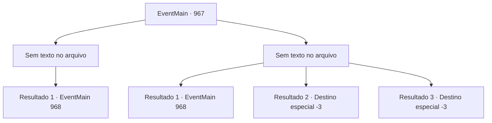

# Eventos principais · 967

[Índice da tabela](index.md) · [Índice geral](../index.md)

ID: `pt:EventMain:967` · Fonte: `EventMain4` · Versão: 1.2.47.

Mapeamento estático dos arquivos; a disponibilidade e a execução dependem do estado da run.

## Texto do evento

*Sem texto no arquivo.*

## Dados de entrada

```json
{
  "id": 967,
  "grade": 1,
  "normalGoal": "",
  "required": ""
}
```

## Mapa das escolhas



## Escolhas e resultados

### Escolha 1

*Sem texto no arquivo; o papel dessa opção depende da interface do jogo.*

Requisitos e outros campos da escolha:

```json
{
  "required": ""
}
```

#### Resultado 1.1

Você derrota o monstro que guarda a porta e abre a porta para o porão. Como Charlie disse, o interior do prédio parece partes de um ser vivo, composto de tecido orgânico. Você encontra Naverr, trancado lá dentro. Julgando pelo estado em que ele se encontra, você assume que ele foi torturado. Naverr te encontra, e seus olhos se arregalam. |drawing_naverrFace| 

 "O que...? Como você...?"

 Mas ele falha em se aproximar. Há um campo de força invisível, agindo como uma gaiola, impedindo Naverr de escapar. Examinando o campo de força, você encontra alguns símbolos exóticos. De acordo com Naverr, os devoradores de almas interagiram com os símbolos para abrir e fechar a gaiola.

Continuação registrada: [Evento 968](0968.md) na mesma tabela.

```json
{
  "required": "",
  "chance": "1",
  "nextEvent": 968,
  "type": 2,
  "reward": ""
}
```

### Escolha 2

*Sem texto no arquivo; o papel dessa opção depende da interface do jogo.*

Requisitos e outros campos da escolha:

```json
{
  "required": ""
}
```

#### Resultado 2.1

Os tentáculos do monstro atacam você implacavelmente. Enquanto você está ocupado se defendendo, um raio de eletricidade eletrocuta o monstro. Você aproveita a oportunidade e destrói sua cabeça. Você passa pelo cadáver, abrindo a porta para o porão. Como Charlie disse, o interior do prédio parece partes de um ser vivo, composto de tecido orgânico. Você encontra Naverr, trancado dentro. Julgando pelo estado em que ele se encontra, você assume que ele foi torturado. Naverr te encontra, e seus olhos se arregalam. |drawing_naverrFace| 

 "O que...? Como você..."

 Mas ele não consegue se aproximar. Há um campo de força invisível, agindo como uma gaiola, impedindo Naverr de escapar. Examinando o campo de força, você encontra alguns símbolos exóticos. Segundo Naverr, os devoradores de almas interagiam com os símbolos para abrir e fechar a gaiola.

Continuação registrada: [Evento 968](0968.md) na mesma tabela.

```json
{
  "required": "1_0_2|1_1_2",
  "chance": "1",
  "nextEvent": 968,
  "type": 2,
  "reward": "0_0_-1|0_1_-1"
}
```

#### Resultado 2.2

Os tentáculos do monstro agarram sua cabeça. Com seus dentes afiados, ele tritura seu crânio em pedaços.

Continuação registrada: [Destino especial `-3`](../destinos-especiais.md).

```json
{
  "required": "2_0_2",
  "chance": "1",
  "nextEvent": -3,
  "type": 2,
  "reward": "0_0_-1|0_1_-1"
}
```

#### Resultado 2.3

Os tentáculos do monstro agarram sua cabeça. Com seus dentes afiados, ele tritura seu crânio em pedaços.

Continuação registrada: [Destino especial `-3`](../destinos-especiais.md).

```json
{
  "required": "2_1_2",
  "chance": "1",
  "nextEvent": -3,
  "type": 2,
  "reward": "0_0_-1|0_1_-1"
}
```

## Referências que chegam a este evento

- [Evento 966 · escolha 1 · resultado 2](0966.md#escolha-1)
- [Evento 966 · escolha 2 · resultado 2](0966.md#escolha-2)
