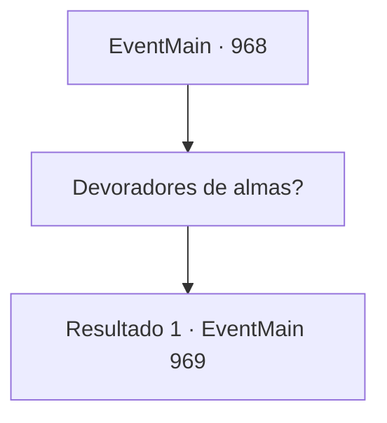

# Eventos principais · 968

[Índice da tabela](index.md) · [Índice geral](../index.md)

ID: `pt:EventMain:968` · Fonte: `EventMain4` · Versão: 1.2.47.

Mapeamento estático dos arquivos; a disponibilidade e a execução dependem do estado da run.

## Texto do evento

*Sem texto no arquivo.*

## Dados de entrada

```json
{
  "id": 968,
  "grade": 1,
  "normalGoal": "",
  "required": ""
}
```

## Mapa das escolhas



## Escolhas e resultados

### Escolha 1

Devoradores de almas?

Requisitos e outros campos da escolha:

```json
{
  "required": "5_691_0"
}
```

#### Resultado 1.1

Você pergunta a Naverr o que ele quer dizer com devoradores de almas. Ele responde colocando os dedos sob o queixo e movendo-os. 

 "Você viu um lá fora, não viu? Os monstros com tentáculos em seus queixos. Eles se alimentam de almas humanas. Por isso os chamamos de devoradores de almas."


Continuação registrada: [Evento 969](0969.md) na mesma tabela.

```json
{
  "required": "",
  "chance": "1",
  "nextEvent": 969,
  "type": 2,
  "reward": "5_691_1"
}
```

## Referências que chegam a este evento

- [Evento 966 · escolha 1 · resultado 1](0966.md#escolha-1)
- [Evento 966 · escolha 2 · resultado 1](0966.md#escolha-2)
- [Evento 967 · escolha 1 · resultado 1](0967.md#escolha-1)
- [Evento 967 · escolha 2 · resultado 1](0967.md#escolha-2)
