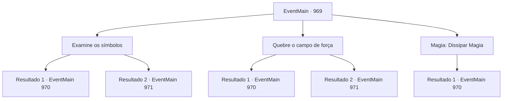

# Eventos principais · 969

[Índice da tabela](index.md) · [Índice geral](../index.md)

ID: `pt:EventMain:969` · Fonte: `EventMain4` · Versão: 1.2.47.

Mapeamento estático dos arquivos; a disponibilidade e a execução dependem do estado da run.

## Texto do evento

*Sem texto no arquivo.*

## Dados de entrada

```json
{
  "id": 969,
  "grade": 1,
  "normalGoal": "",
  "required": ""
}
```

## Mapa das escolhas



## Escolhas e resultados

### Escolha 1

Examine os símbolos

Requisitos e outros campos da escolha:

```json
{
  "required": ""
}
```

#### Resultado 1.1

Você examina os símbolos no campo de força, desvendando a estrutura de sua magia. Ao tocar nos símbolos e girá-los, o campo de força derrete. O Professor Naverr te abraça apertado, expressando sua gratidão. 

 "Obrigado por me tirar daqui! Mas os devoradores de almas... eles levaram a Lente de Éter de mim. Aquele que parecia ser um comandante..."

 Segundo ele, esse líder deve estar nas partes mais profundas deste lugar semelhante a um órgão.

Continuação registrada: [Evento 970](0970.md) na mesma tabela.

```json
{
  "required": "",
  "chance": "1|0_7_1",
  "nextEvent": 970,
  "type": 0,
  "reward": "5_692_1"
}
```

#### Resultado 1.2

Você examina os símbolos no campo de força, mas não consegue reunir dados valiosos. Naverr fala, frustrado, que o campo de força não é o que importa agora. 

 "Aprecio sua preocupação por mim, mas recuperar a Lente de Éter deve ser nossa prioridade.  Um dos devoralmas a levou de mim. Aquele que parecia ser o comandante..."

 Ele joga para você uma pequena bolsa de couro através da gaiola, dizendo que seu plano está escrito lá dentro. Dentro, você encontra um pequeno pingente de medalhão. Você o abre e encontra uma pequena carta dentro. 'Eu quebrei um selo antigo e obtive a 'Lente Ether' um componente da chave que abrirá o caminho para o Plano Astral. Mas isso convocou entidades desconhecidas que devoram almas. Eu as chamei de 'devoradores de almas'. De qualquer forma, eles estão tentando entrar no Plano Astral, onde todas as almas acabam, e eu preciso de sua ajuda para detê-los. Venha para o Olho Azul da Selva de Andaria na noite em que a lua carmesim se levanta. Destrua o portal no momento em que eles cruzarem para o Plano Astral. Então podemos prendê-los na fenda dimensional.'

Continuação registrada: [Evento 971](0971.md) na mesma tabela.

```json
{
  "required": "",
  "chance": "25",
  "nextEvent": 971,
  "type": 1,
  "reward": "3_317_1|0_4_100"
}
```

### Escolha 2

Quebre o campo de força

Requisitos e outros campos da escolha:

```json
{
  "required": ""
}
```

#### Resultado 2.1

Você soca e bate no campo de força. Ele consegue refletir seus ataques algumas vezes, mas eventualmente se abre. O Professor Naverr te abraça apertado, expressando sua gratidão. 

 "Obrigado por me tirar daqui! Mas os devoradores de almas... eles levaram a Lente de Éter de mim. Aquele que parecia ser um comandante..."

 Segundo ele, esse líder deve estar nas partes mais profundas deste lugar semelhante a um órgão. 

 "Vamos então."


Continuação registrada: [Evento 970](0970.md) na mesma tabela.

```json
{
  "required": "",
  "chance": "1|0_5_1",
  "nextEvent": 970,
  "type": 0,
  "reward": "5_692_1"
}
```

#### Resultado 2.2

Você soca e bate no campo de força. Mas o campo de força não se move, muito menos se quebra. Naverr fala, frustrado, que o campo de força não é o que importa agora. 

 "Aprecio sua preocupação por mim, mas recuperar a Lente de Éter deve ser nossa prioridade.  Um dos devoralmas a levou de mim. Aquele que parecia ser o comandante..."

 Ele joga para você uma pequena bolsa de couro através da gaiola, dizendo que seu plano está escrito lá dentro. Dentro, você encontra um pequeno pingente de medalhão. Você o abre e encontra uma pequena carta dentro. 'Eu quebrei um selo antigo e obtive a 'Lente de Éter'; um componente da chave que abrirá o caminho para o Plano Astral. Mas isso convocou entidades desconhecidas que devoram almas. Eu as chamei de 'devoradores de almas.' De qualquer forma, eles estão tentando entrar no Plano Astral, onde todas as almas acabam, e eu preciso da sua ajuda para detê-los. Venha para o Olho Azul da Selva de Andaria na noite em que a lua carmesim se levantar. Destrua o portal no momento em que eles cruzarem para o Plano Astral. Então podemos prendê-los na fenda dimensional.'

Continuação registrada: [Evento 971](0971.md) na mesma tabela.

```json
{
  "required": "",
  "chance": "50",
  "nextEvent": 971,
  "type": 1,
  "reward": "3_317_1|0_4_100"
}
```

### Escolha 3

Magia: Dissipar Magia

Requisitos e outros campos da escolha:

```json
{
  "required": "20_0_2|1_1_2"
}
```

#### Resultado 3.1

Você quebra a magia que mantém o campo de força com seu feitiço. O campo de força derrete. Professor Naverr te abraça apertado, expressando sua gratidão. 

 "Obrigado por me tirar daqui! Mas os devoradores de almas... eles levaram a Lente de Éter de mim. Aquele que parecia ser um comandante..."

 Segundo ele, esse líder deve estar nas partes mais profundas deste lugar semelhante a um órgão. 

 "Vamos então."


Continuação registrada: [Evento 970](0970.md) na mesma tabela.

```json
{
  "required": "",
  "chance": "1",
  "nextEvent": 970,
  "type": 2,
  "reward": "0_1_-1|5_692_1"
}
```

## Referências que chegam a este evento

- [Evento 968 · escolha 1 · resultado 1](0968.md#escolha-1)
