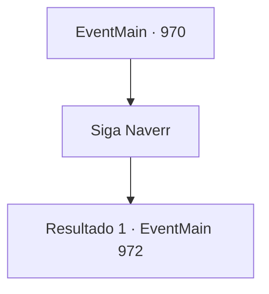

# Eventos principais · 970

[Índice da tabela](index.md) · [Índice geral](../index.md)

ID: `pt:EventMain:970` · Fonte: `EventMain4` · Versão: 1.2.47.

Mapeamento estático dos arquivos; a disponibilidade e a execução dependem do estado da run.

## Texto do evento

*Sem texto no arquivo.*

## Dados de entrada

```json
{
  "id": 970,
  "grade": 1,
  "normalGoal": "",
  "required": ""
}
```

## Mapa das escolhas



## Escolhas e resultados

### Escolha 1

Siga Naverr

Requisitos e outros campos da escolha:

```json
{
  "required": ""
}
```

#### Resultado 1.1

Você segue Naverr. A distração lá fora deve estar funcionando. Você percebe um grupo de devoradores de almas correndo do lado de fora. Você e Naverr passam sorrateiramente por eles, indo mais fundo. Enquanto os dois caminham pelo estreito corredor feito de células roxas, um espaço amplo é revelado. Fascículos complicados estão conectados com esferas com símbolos que você nunca viu antes, e um devoralmas roxo está examinando-os. 

 "Lá, bem ali. É aquele. Eu vou pela direita, você pega pela esquerda."

 Naverr puxa um facão de sua cintura, então começa a caminhar em direção à direita do devoralmas.

Continuação registrada: [Evento 972](0972.md) na mesma tabela.

```json
{
  "required": "",
  "chance": "1",
  "nextEvent": 972,
  "type": 2,
  "reward": ""
}
```

## Referências que chegam a este evento

- [Evento 969 · escolha 1 · resultado 1](0969.md#escolha-1)
- [Evento 969 · escolha 2 · resultado 1](0969.md#escolha-2)
- [Evento 969 · escolha 3 · resultado 1](0969.md#escolha-3)
