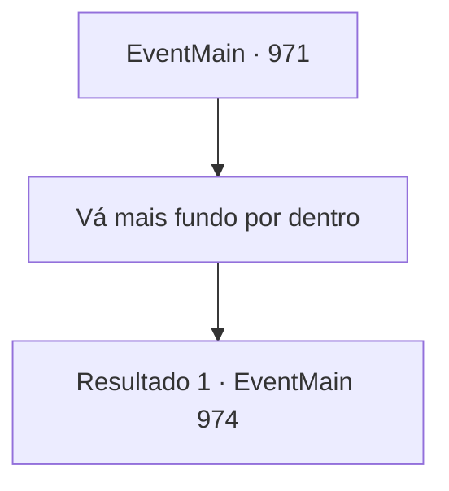

# Eventos principais · 971

[Índice da tabela](index.md) · [Índice geral](../index.md)

ID: `pt:EventMain:971` · Fonte: `EventMain4` · Versão: 1.2.47.

Mapeamento estático dos arquivos; a disponibilidade e a execução dependem do estado da run.

## Texto do evento

*Sem texto no arquivo.*

## Dados de entrada

```json
{
  "id": 971,
  "grade": 1,
  "normalGoal": "",
  "required": ""
}
```

## Mapa das escolhas



## Escolhas e resultados

### Escolha 1

Vá mais fundo por dentro

Requisitos e outros campos da escolha:

```json
{
  "required": ""
}
```

#### Resultado 1.1

Você sai da sala onde está o Naverr.  Ao passar pelo corredor sinuoso,  você encontra o devoralmas.  Sem hesitar, ele levanta a mão e dispara um raio carmesim.

Continuação registrada: [Evento 974](0974.md) na mesma tabela.

```json
{
  "required": "",
  "chance": "1",
  "nextEvent": 974,
  "type": 2,
  "reward": "6_0_170",
  "place": 15
}
```

## Referências que chegam a este evento

- [Evento 969 · escolha 1 · resultado 2](0969.md#escolha-1)
- [Evento 969 · escolha 2 · resultado 2](0969.md#escolha-2)
