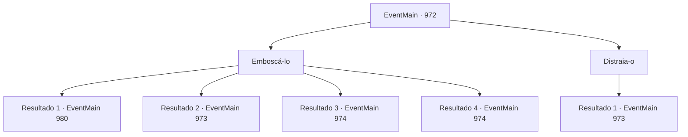

# Eventos principais · 972

[Índice da tabela](index.md) · [Índice geral](../index.md)

ID: `pt:EventMain:972` · Fonte: `EventMain4` · Versão: 1.2.47.

Mapeamento estático dos arquivos; a disponibilidade e a execução dependem do estado da run.

## Texto do evento

*Sem texto no arquivo.*

## Dados de entrada

```json
{
  "id": 972,
  "grade": 1,
  "normalGoal": "",
  "required": ""
}
```

## Mapa das escolhas



## Escolhas e resultados

### Escolha 1

Emboscá-lo

Requisitos e outros campos da escolha:

```json
{
  "required": ""
}
```

#### Resultado 1.1

Você se aproxima sorrateiramente do lado esquerdo do devoralmas. Ele está completamente alheio à sua presença. Num instante, você e Naverr esmagam seu crânio. Ele desaba no chão, sangrando fluidos roxos. Naverr encontra a Lente de Éter em seu corpo. Dependendo do ângulo que você vê, a Lente de Éter muda de cor. Naverr examina minuciosamente a lente antes de entregá-la a você. 

 "Cuide bem dela, agora. Certo. Vamos sair daqui."

 Você e Naverr saem. Vendo os dois seguros, Charlie dá outro sinal. Lana e Lodor desaparecem da vista dos devoradores de almas. 

 "Professor Naverr, presumo? Siga-me, por favor."


Continuação registrada: [Evento 980](0980.md) na mesma tabela.

```json
{
  "required": "5_692_1",
  "chance": "1|0_6_1",
  "nextEvent": 980,
  "type": 0,
  "reward": "3_315_1"
}
```

#### Resultado 1.2

Você se aproxima sorrateiramente do lado esquerdo do devoralmas. Mas ele percebe você e imediatamente começa a atacar com seus tentáculos.

Continuação registrada: [Evento 973](0973.md) na mesma tabela.

```json
{
  "required": "5_692_1",
  "chance": "15",
  "nextEvent": 973,
  "type": 1,
  "reward": "6_2_170",
  "place": 15
}
```

#### Resultado 1.3

Você se aproxima sorrateiramente do lado esquerdo do devoralmas. Ele está completamente alheio à sua presença enquanto você desfere um ataque sorrateiro. 

 "KKKKIIIIIEEEE!"

 Fluido roxo espirra, e o devoralmas começa a atacá-lo com raiva.

Continuação registrada: [Evento 974](0974.md) na mesma tabela.

```json
{
  "required": "18_692_1",
  "chance": "1|0_6_1",
  "nextEvent": 974,
  "type": 0,
  "reward": "6_2_170",
  "place": 15
}
```

#### Resultado 1.4

Você se aproxima sorrateiramente do lado esquerdo do devoralmas. Mas ele percebe você e imediatamente começa a atacar com seus tentáculos.

Continuação registrada: [Evento 974](0974.md) na mesma tabela.

```json
{
  "required": "18_692_1",
  "chance": "22",
  "nextEvent": 974,
  "type": 1,
  "reward": "6_0_170",
  "place": 15
}
```

### Escolha 2

Distraia-o

Requisitos e outros campos da escolha:

```json
{
  "required": "5_692_1"
}
```

#### Resultado 2.1

Você faz barulho intencionalmente, desviando a atenção do devoralmas para você. Naverr aproveita a oportunidade e balança seu facão em suas costas. 

 "KKKKIIIIIEEEE!"

 Mas Naverr não consegue matá-lo com um único golpe. O devoralmas começa a atacar você com raiva.

Continuação registrada: [Evento 973](0973.md) na mesma tabela.

```json
{
  "required": "",
  "chance": "1",
  "nextEvent": 973,
  "type": 2,
  "reward": "6_2_170",
  "place": 15
}
```

## Referências que chegam a este evento

- [Evento 970 · escolha 1 · resultado 1](0970.md#escolha-1)
