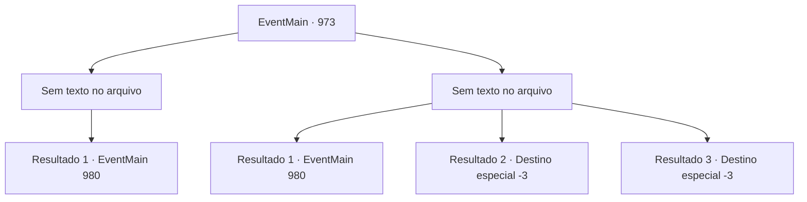

# Eventos principais · 973

[Índice da tabela](index.md) · [Índice geral](../index.md)

ID: `pt:EventMain:973` · Fonte: `EventMain4` · Versão: 1.2.47.

Mapeamento estático dos arquivos; a disponibilidade e a execução dependem do estado da run.

## Texto do evento

*Sem texto no arquivo.*

## Dados de entrada

```json
{
  "id": 973,
  "grade": 1,
  "normalGoal": "",
  "required": ""
}
```

## Mapa das escolhas



## Escolhas e resultados

### Escolha 1

*Sem texto no arquivo; o papel dessa opção depende da interface do jogo.*

Requisitos e outros campos da escolha:

```json
{
  "required": ""
}
```

#### Resultado 1.1

O devoralmas que parece ser o comandante é morto por você e Naverr. Ele desaba no chão, sangrando fluidos roxos. Naverr encontra a Lente Ether em seu corpo. Dependendo do ângulo que você vê, a Lente Ether muda de cor. Naverr examina minuciosamente a lente antes de entregá-la a você. 

 "Cuide bem dela, agora. Certo. Vamos sair daqui."

 Você e Naverr saem. Vendo os dois seguros, Charlie dá outro sinal. Lana e Lodor desaparecem da vista dos devoradores de almas. 

 "Professor Naverr, presumo? Siga-me, por favor."


Continuação registrada: [Evento 980](0980.md) na mesma tabela.

```json
{
  "required": "",
  "chance": "1",
  "nextEvent": 980,
  "type": 2,
  "reward": "3_315_1"
}
```

### Escolha 2

*Sem texto no arquivo; o papel dessa opção depende da interface do jogo.*

Requisitos e outros campos da escolha:

```json
{
  "required": ""
}
```

#### Resultado 2.1

Uma onda de choque magia do devoralmas te joga para trás. Ele então conjura raios carmesim em suas mãos, para te finalizar. Mas Naverr o impede cortando seu braço com seu facão. O devoralmas espirra fluido roxo no chão, gritando de dor. Ele balança suas garras afiadas em direção a Naverr, mas ele elegantemente desvia do ataque, então balança seu facão mais uma vez. Com um alto estalo, o facão parte o crânio do devoralmas ao meio. Finalmente, seu movimento para. 

 "Você está bem? Aqui."

 Naverr te ajuda a se levantar com suas mãos. Ele então encontra a Lente de Éter em seu corpo. Dependendo do ângulo que você vê, a Lente de Éter muda de cor. Naverr examina minuciosamente a lente antes de te entregá-la. 

 "Cuide bem dela, agora. Certo. Vamos sair daqui."

 Você e Naverr saem para fora. Vendo os dois seguros, Charlie dá outro sinal. Lana e Lodor desaparecem da vista dos devoradores de almas. 

 "Professor Naverr, presumo? Me siga, por favor."


Continuação registrada: [Evento 980](0980.md) na mesma tabela.

```json
{
  "required": "1_0_2|1_1_2",
  "chance": "1",
  "nextEvent": 980,
  "type": 2,
  "reward": "0_0_-1|0_1_-1|3_315_1"
}
```

#### Resultado 2.2

Uma onda de choque magia do devoralmas te joga para trás. A parede roxa de carne lentamente começa a te engolir.

Continuação registrada: [Destino especial `-3`](../destinos-especiais.md).

```json
{
  "required": "2_0_2",
  "chance": "1",
  "nextEvent": -3,
  "type": 2,
  "reward": "0_0_-1|0_1_-1"
}
```

#### Resultado 2.3

Uma onda de choque magia do devoralmas te joga para trás. A parede roxa de carne lentamente começa a te engolir.

Continuação registrada: [Destino especial `-3`](../destinos-especiais.md).

```json
{
  "required": "2_1_2",
  "chance": "1",
  "nextEvent": -3,
  "type": 2,
  "reward": "0_0_-1|0_1_-1"
}
```

## Referências que chegam a este evento

- [Evento 972 · escolha 1 · resultado 2](0972.md#escolha-1)
- [Evento 972 · escolha 2 · resultado 1](0972.md#escolha-2)
