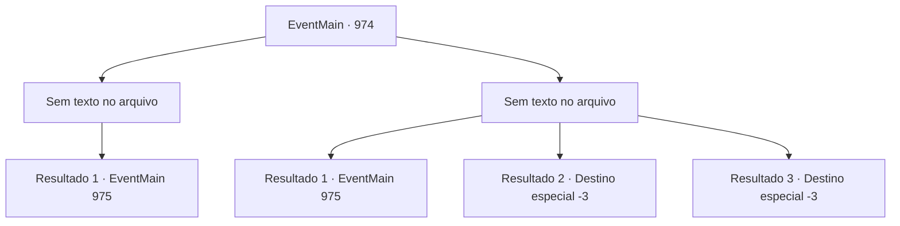

# Eventos principais · 974

[Índice da tabela](index.md) · [Índice geral](../index.md)

ID: `pt:EventMain:974` · Fonte: `EventMain4` · Versão: 1.2.47.

Mapeamento estático dos arquivos; a disponibilidade e a execução dependem do estado da run.

## Texto do evento

*Sem texto no arquivo.*

## Dados de entrada

```json
{
  "id": 974,
  "grade": 1,
  "normalGoal": "",
  "required": ""
}
```

## Mapa das escolhas



## Escolhas e resultados

### Escolha 1

*Sem texto no arquivo; o papel dessa opção depende da interface do jogo.*

Requisitos e outros campos da escolha:

```json
{
  "required": ""
}
```

#### Resultado 1.1

Você mata o devoralmas.  Ele desaba no chão, sangrando fluidos roxos.  Quando você sai, Charlie vê você saindo do prédio e pergunta onde está o Naverr.  Você diz a ele que Naverr está preso dentro de um campo de força e que você não conseguiu libertá-lo.  

 "Hm... Nossa distração não vai durar para sempre. Se eu puder entrar, talvez consiga dissipar o campo de força por mim mesmo.  Mas essas criaturas vão voltar. Então - como devemos fazer isso?"


Continuação registrada: [Evento 975](0975.md) na mesma tabela.

```json
{
  "required": "",
  "chance": "1",
  "nextEvent": 975,
  "type": 2,
  "reward": ""
}
```

### Escolha 2

*Sem texto no arquivo; o papel dessa opção depende da interface do jogo.*

Requisitos e outros campos da escolha:

```json
{
  "required": ""
}
```

#### Resultado 2.1

Você está lutando desesperadamente contra o devoralmas.  A execução habilidosa de seus feitiços está te empurrando cada vez mais para longe.  Finalmente, ele consegue te atingir com uma onda de choque, derrotando você.  Você é jogado de volta ao chão, e ele começa a reunir relâmpagos carmesins em seus dedos para acabar com você.  Mas então, um fragmento de gelo é lançado na cabeça do devoralmas.  

 "Eu estava me perguntando o que te demorou tanto. Fico feliz por ter chegado a tempo."

  Ele desaba no chão, sangrando fluidos roxos.  Após acabar com o devoralmas, Charlie te pergunta onde está o Naverr.  

 "Hm... Nossa distração não vai durar para sempre. Se eu puder entrar, talvez consiga dissipar o campo de força por mim mesmo.  Mas essas criaturas vão voltar. Então - como devemos fazer isso?"


Continuação registrada: [Evento 975](0975.md) na mesma tabela.

```json
{
  "required": "1_0_2|1_1_2",
  "chance": "1",
  "nextEvent": 975,
  "type": 2,
  "reward": "0_0_-1|0_1_-1"
}
```

#### Resultado 2.2

Uma onda de choque magia do devoralmas te joga para trás. A parede roxa de carne lentamente começa a te engolir.

Continuação registrada: [Destino especial `-3`](../destinos-especiais.md).

```json
{
  "required": "2_0_2",
  "chance": "1",
  "nextEvent": -3,
  "type": 2,
  "reward": "0_0_-1|0_1_-1"
}
```

#### Resultado 2.3

Uma onda de choque magia do devoralmas te joga para trás. A parede roxa de carne lentamente começa a te engolir.

Continuação registrada: [Destino especial `-3`](../destinos-especiais.md).

```json
{
  "required": "2_1_2",
  "chance": "1",
  "nextEvent": -3,
  "type": 2,
  "reward": "0_0_-1|0_1_-1"
}
```

## Referências que chegam a este evento

- [Evento 971 · escolha 1 · resultado 1](0971.md#escolha-1)
- [Evento 972 · escolha 1 · resultado 3](0972.md#escolha-1)
- [Evento 972 · escolha 1 · resultado 4](0972.md#escolha-1)
