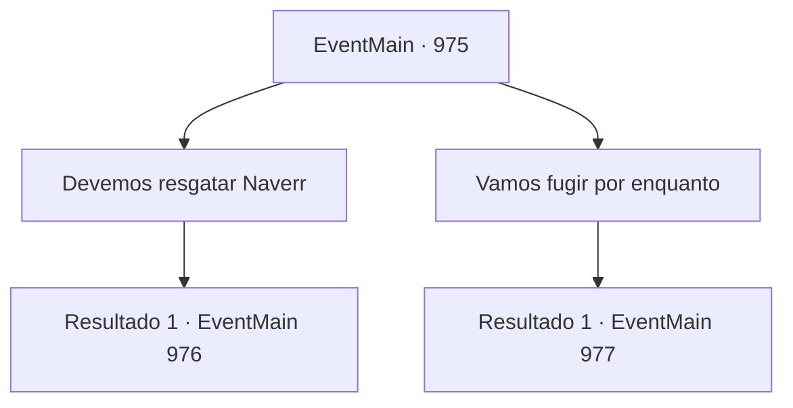

# Eventos principais · 975

[Índice da tabela](index.md) · [Índice geral](../index.md)

ID: `pt:EventMain:975` · Fonte: `EventMain4` · Versão: 1.2.47.

Mapeamento estático dos arquivos; a disponibilidade e a execução dependem do estado da run.

## Texto do evento

*Sem texto no arquivo.*

## Dados de entrada

```json
{
  "id": 975,
  "grade": 1,
  "normalGoal": "",
  "required": ""
}
```

## Mapa das escolhas



## Escolhas e resultados

### Escolha 1

Devemos resgatar Naverr

Requisitos e outros campos da escolha:

```json
{
  "required": ""
}
```

#### Resultado 1.1

Você afirma que Naverr seja resgatado mais uma vez. 

 "Tudo bem. Faremos isso. Mas, se as coisas não correrem a nosso favor, devemos escapar imediatamente."

 Charlie então pede para você levá-lo até Naverr. Você navega de volta para a gaiola dele, e assim como Charlie esperava, um grupo de devoradores de almas bloqueia seu caminho.

Continuação registrada: [Evento 976](0976.md) na mesma tabela.

```json
{
  "required": "",
  "chance": "1",
  "nextEvent": 976,
  "type": 2,
  "reward": "6_0_175",
  "place": 15
}
```

### Escolha 2

Vamos fugir por enquanto

Requisitos e outros campos da escolha:

```json
{
  "required": ""
}
```

#### Resultado 2.1

Você rapidamente toma sua decisão. Charlie concorda com a cabeça. 

 "Tudo bem. Vamos fazer isso. Fique perto."

 Você se aproxima de Charlie. Ele começa a desenhar um círculo mágico com pó prateado. Depois de terminar de lançar seu feitiço, o ambiente muda com um flash brilhante. Você se encontra em uma cabana antiga e desgastada. 

 "Este é nosso esconderijo. Eu desenhei um círculo mágico aqui também antecipadamente, para que possamos voltar rapidamente e em segurança."

 Charlie se senta em uma cadeira de madeira. Logo, Lana e Lodor também chegam. 

 "Ufa... Mal conseguimos despistá-los. Mas... onde está Naverr?"

 Charlie balança a cabeça em resposta à pergunta de Lana. Lana xinga, e então se senta no chão também. Lodor fala, olhando para você. 

 "Pena que as coisas aconteceram assim. Mas... é até onde podemos ajudar, receio. Essas coisas são muito mais perigosas do que esperávamos."

 Charlie concorda também. Os três saem, dizendo que não vão impedi-lo de tentar novamente sozinho.

Continuação registrada: [Evento 977](0977.md) na mesma tabela.

```json
{
  "required": "",
  "chance": "1",
  "nextEvent": 977,
  "type": 2,
  "reward": ""
}
```

## Referências que chegam a este evento

- [Evento 974 · escolha 1 · resultado 1](0974.md#escolha-1)
- [Evento 974 · escolha 2 · resultado 1](0974.md#escolha-2)
