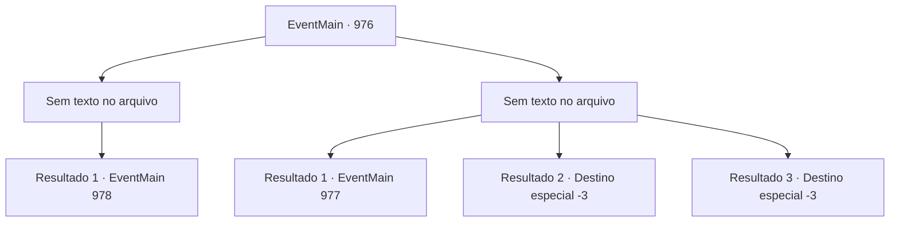

# Eventos principais · 976

[Índice da tabela](index.md) · [Índice geral](../index.md)

ID: `pt:EventMain:976` · Fonte: `EventMain4` · Versão: 1.2.47.

Mapeamento estático dos arquivos; a disponibilidade e a execução dependem do estado da run.

## Texto do evento

*Sem texto no arquivo.*

## Dados de entrada

```json
{
  "id": 976,
  "grade": 1,
  "normalGoal": "",
  "required": ""
}
```

## Mapa das escolhas



## Escolhas e resultados

### Escolha 1

*Sem texto no arquivo; o papel dessa opção depende da interface do jogo.*

Requisitos e outros campos da escolha:

```json
{
  "required": ""
}
```

#### Resultado 1.1

Você e Charlie derrotam os devoralmas e encontram a Lente de Éter que o comandante deles possui. Em seguida, vocês imediatamente se dirigem ao local onde o Naverr está preso. Naverr parece ainda mais surpreso do que antes. 

 "*suspiro*... Você...!"

 Ignorando-o, Charlie examina os símbolos no campo de força. Ele então lança 'Dispersar Magia', quebrando o campo de força. Assim que Naverr é libertado, ele pergunta se você obteve a Lente de Éter, ao que você responde sim. 

 "Isso é... um grande alívio! Obrigado. Eu realmente agradeço."

 Enquanto isso, Charlie desenha um círculo mágico com pó prateado. Depois de terminar de lançar seu feitiço, o ambiente muda com um flash brilhante. Você se encontra em uma cabana antiga e desgastada. 

 "Este é nosso esconderijo. Eu desenhei um círculo mágico aqui também antecipadamente, para que possamos retornar rapidamente e em segurança."

 Charlie se senta em uma cadeira de madeira. Logo, Lana e Lodor também chegam. 

 "Isso foi um trabalho muito bem feito."

 diz Lodor, vendo Naverr ser resgatado com segurança. Lana fica ao lado dele, sorrindo também. 

 "Sua família está esperando, velho. É melhor voltar logo."

 Mas então, Naverr olha para você, perdido em pensamentos.

Continuação registrada: [Evento 978](0978.md) na mesma tabela.

```json
{
  "required": "",
  "chance": "1",
  "nextEvent": 978,
  "type": 2,
  "reward": "3_315_1"
}
```

### Escolha 2

*Sem texto no arquivo; o papel dessa opção depende da interface do jogo.*

Requisitos e outros campos da escolha:

```json
{
  "required": ""
}
```

#### Resultado 2.1

A onda de devoradores de almas pressiona você impiedosamente. Um deles agarra sua perna. Você perde o equilíbrio e cai. Tentáculos cobertos de dentes afiados se aproximam de você. Justo quando você está prestes a ter sua cabeça devorada, Charlie dispara raios nos devoradores de almas. 

 "Depressa!"

 Enquanto os devoradores de almas estão sendo eletrocutados, Charlie te ajuda a se levantar. Com sua ajuda, você consegue escapar do covil dos devoradores de almas. Você e Charlie correm por minutos e minutos, longe dos devoradores de almas. Quando finalmente se sente seguro, Charlie ofega por ar. 

 "*ofegante*... *ofegante*... Isso... isso é o máximo que posso te ajudar. Eu e meus companheiros não iremos mais adiante."

 Com isso, Charlie se despede de você.

Continuação registrada: [Evento 977](0977.md) na mesma tabela.

```json
{
  "required": "1_0_2|1_1_2",
  "chance": "1",
  "nextEvent": 977,
  "type": 2,
  "reward": "0_0_-1|0_1_-1"
}
```

#### Resultado 2.2

A onda de devoradores de almas te pressiona impiedosamente. Um deles agarra sua perna. Você perde o equilíbrio e cai. Tentáculos cobertos de dentes afiados se aproximam de você. Você nem consegue gritar enquanto seu rosto é devorado.

Continuação registrada: [Destino especial `-3`](../destinos-especiais.md).

```json
{
  "required": "2_0_2",
  "chance": "1",
  "nextEvent": -3,
  "type": 2,
  "reward": "0_0_-1|0_1_-1"
}
```

#### Resultado 2.3

A onda de devoradores de almas te pressiona impiedosamente. Um deles agarra sua perna. Você perde o equilíbrio e cai. Tentáculos cobertos de dentes afiados se aproximam de você. Você nem consegue gritar enquanto seu rosto é devorado.

Continuação registrada: [Destino especial `-3`](../destinos-especiais.md).

```json
{
  "required": "2_1_2",
  "chance": "1",
  "nextEvent": -3,
  "type": 2,
  "reward": "0_0_-1|0_1_-1"
}
```

## Referências que chegam a este evento

- [Evento 975 · escolha 1 · resultado 1](0975.md#escolha-1)
