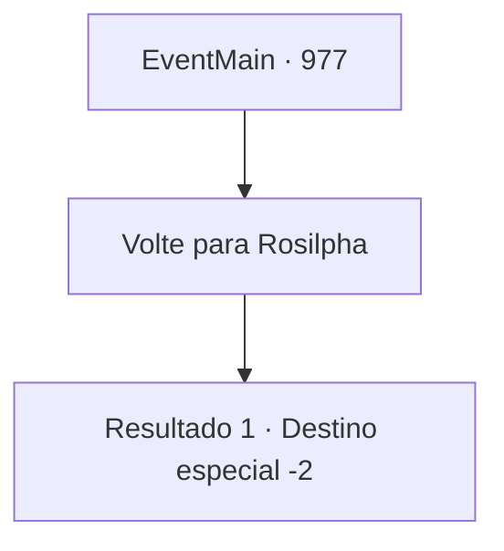

# Eventos principais · 977

[Índice da tabela](index.md) · [Índice geral](../index.md)

ID: `pt:EventMain:977` · Fonte: `EventMain4` · Versão: 1.2.47.

Mapeamento estático dos arquivos; a disponibilidade e a execução dependem do estado da run.

## Texto do evento

*Sem texto no arquivo.*

## Dados de entrada

```json
{
  "id": 977,
  "grade": 1,
  "normalGoal": "",
  "required": ""
}
```

## Mapa das escolhas



## Escolhas e resultados

### Escolha 1

Volte para Rosilpha

Requisitos e outros campos da escolha:

```json
{
  "required": ""
}
```

#### Resultado 1.1

Você decide voltar para Sinias e encontrar com Rosilpha.

Continuação registrada: [Destino especial `-2`](../destinos-especiais.md).

```json
{
  "required": "",
  "chance": "1",
  "nextEvent": -2,
  "type": 2,
  "reward": "13_5_9"
}
```

## Referências que chegam a este evento

- [Evento 975 · escolha 2 · resultado 1](0975.md#escolha-2)
- [Evento 976 · escolha 2 · resultado 1](0976.md#escolha-2)
