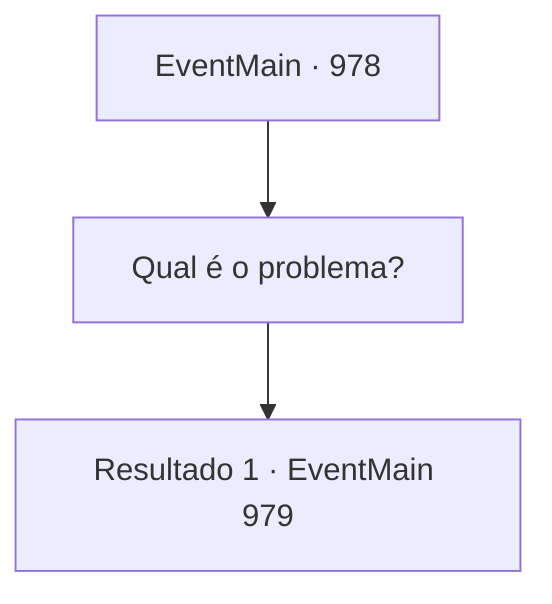

# Eventos principais · 978

[Índice da tabela](index.md) · [Índice geral](../index.md)

ID: `pt:EventMain:978` · Fonte: `EventMain4` · Versão: 1.2.47.

Mapeamento estático dos arquivos; a disponibilidade e a execução dependem do estado da run.

## Texto do evento

*Sem texto no arquivo.*

## Dados de entrada

```json
{
  "id": 978,
  "grade": 1,
  "normalGoal": "",
  "required": ""
}
```

## Mapa das escolhas



## Escolhas e resultados

### Escolha 1

Qual é o problema?

Requisitos e outros campos da escolha:

```json
{
  "required": ""
}
```

#### Resultado 1.1

Ele finalmente abre a boca. 

 "Os devoradores de almas ainda não sabem a localização exata do Disco da Lua. Mas... deve haver algum tempo restante. Preciso voltar para minha família. Entrarei em contato com você - vá para Brikkalua."


Continuação registrada: [Evento 979](0979.md) na mesma tabela.

```json
{
  "required": "",
  "chance": "1",
  "nextEvent": 979,
  "type": 2,
  "reward": ""
}
```

## Referências que chegam a este evento

- [Evento 976 · escolha 1 · resultado 1](0976.md#escolha-1)
- [Evento 980 · escolha 1 · resultado 1](0980.md#escolha-1)
- [Evento 983 · escolha 2 · resultado 1](0983.md#escolha-2)
- [Evento 984 · escolha 1 · resultado 1](0984.md#escolha-1)
- [Evento 984 · escolha 2 · resultado 1](0984.md#escolha-2)
