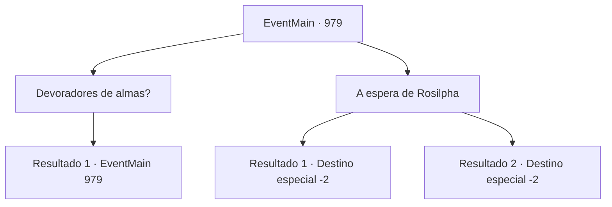

# Eventos principais · 979

[Índice da tabela](index.md) · [Índice geral](../index.md)

ID: `pt:EventMain:979` · Fonte: `EventMain4` · Versão: 1.2.47.

Mapeamento estático dos arquivos; a disponibilidade e a execução dependem do estado da run.

## Texto do evento

*Sem texto no arquivo.*

## Dados de entrada

```json
{
  "id": 979,
  "grade": 1,
  "normalGoal": "",
  "required": ""
}
```

## Mapa das escolhas



## Escolhas e resultados

### Escolha 1

Devoradores de almas?

Requisitos e outros campos da escolha:

```json
{
  "required": "5_691_0"
}
```

#### Resultado 1.1

Você pergunta a Naverr o que ele quer dizer com devoradores de almas. Ele responde colocando os dedos sob o queixo e movendo-os. 

 "Você viu um lá fora, não viu? Os monstros com tentáculos em seus queixos. Eles se alimentam de almas humanas. Por isso os chamamos de devoradores de almas."


Continuação registrada: [Evento 979](0979.md) na mesma tabela.

```json
{
  "required": "",
  "chance": "1",
  "nextEvent": 979,
  "type": 2,
  "reward": "5_691_1"
}
```

### Escolha 2

A espera de Rosilpha

Requisitos e outros campos da escolha:

```json
{
  "required": "5_691_1"
}
```

#### Resultado 2.1

Você diz a ele que Rosilpha está esperando em Sinias. 

 "Ah, entendi. Então devo entrar em contato com Rosilpha também. Obrigado por me tirar daqui."

 Protegido pelos mercenários, Naverr vai embora, de volta para sua família.

Continuação registrada: [Destino especial `-2`](../destinos-especiais.md).

```json
{
  "required": "18_693_1",
  "chance": "1",
  "nextEvent": -2,
  "type": 2,
  "reward": "13_5_10"
}
```

#### Resultado 2.2

Você diz a ele que Rosilpha está esperando em Sinias. 

 "Ah, entendi. Então devo entrar em contato com Rosilpha também. Obrigado por me tirar daqui."

 Naverr vai embora, de volta para sua família.

Continuação registrada: [Destino especial `-2`](../destinos-especiais.md).

```json
{
  "required": "5_693_1",
  "chance": "1",
  "nextEvent": -2,
  "type": 2,
  "reward": "13_5_10"
}
```

## Referências que chegam a este evento

- [Evento 978 · escolha 1 · resultado 1](0978.md#escolha-1)
- [Evento 979 · escolha 1 · resultado 1](0979.md#escolha-1)
