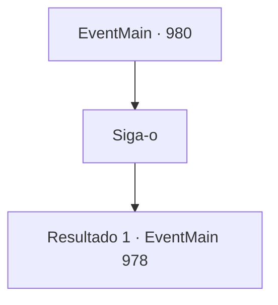

# Eventos principais · 980

[Índice da tabela](index.md) · [Índice geral](../index.md)

ID: `pt:EventMain:980` · Fonte: `EventMain4` · Versão: 1.2.47.

Mapeamento estático dos arquivos; a disponibilidade e a execução dependem do estado da run.

## Texto do evento

*Sem texto no arquivo.*

## Dados de entrada

```json
{
  "id": 980,
  "grade": 1,
  "normalGoal": "",
  "required": ""
}
```

## Mapa das escolhas



## Escolhas e resultados

### Escolha 1

Siga-o

Requisitos e outros campos da escolha:

```json
{
  "required": ""
}
```

#### Resultado 1.1

Você e Naverr seguem Charlie. Ele está desenhando um círculo mágico com pó prateado, longe de onde o devoralmas estava. Depois que ele termina de lançar seu feitiço, o ambiente muda com um flash brilhante. Você se encontra em uma cabana antiga e desgastada. 

 "Este é nosso esconderijo. Eu desenhei um círculo mágico aqui também antecipadamente, para que possamos retornar rapidamente e em segurança."

 Charlie se senta em uma cadeira de madeira. Logo, Lana e Lodor também chegam. 

 "Isso foi um trabalho muito bem feito."

 Diz Lodor, vendo Naverr ser resgatado com segurança. Lana fica ao lado dele, sorrindo também. 

 "Sua família está esperando, velho. É melhor voltar logo."

 Mas então, Naverr olha para você, perdido em pensamentos.

Continuação registrada: [Evento 978](0978.md) na mesma tabela.

```json
{
  "required": "",
  "chance": "1",
  "nextEvent": 978,
  "type": 2,
  "reward": ""
}
```

## Referências que chegam a este evento

- [Evento 972 · escolha 1 · resultado 1](0972.md#escolha-1)
- [Evento 973 · escolha 1 · resultado 1](0973.md#escolha-1)
- [Evento 973 · escolha 2 · resultado 1](0973.md#escolha-2)
