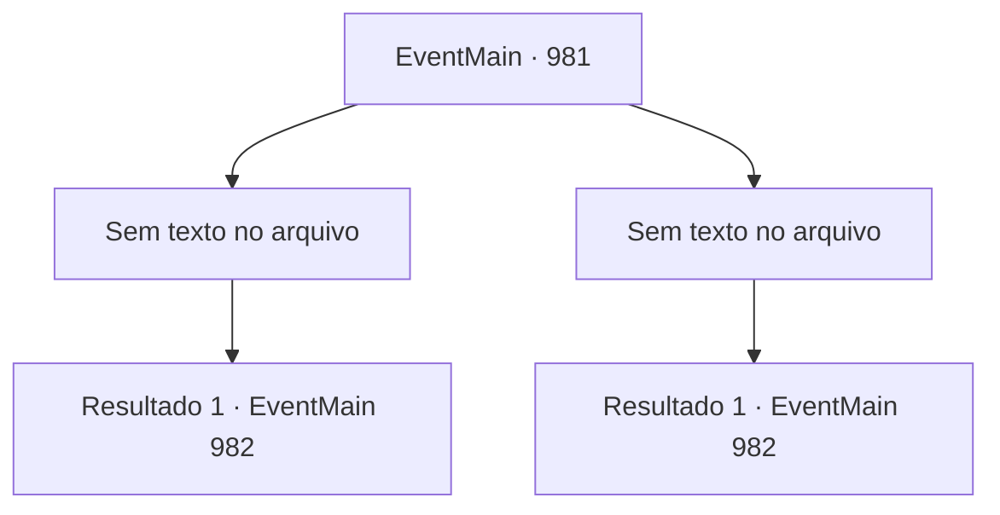

# Eventos principais · 981

[Índice da tabela](index.md) · [Índice geral](../index.md)

ID: `pt:EventMain:981` · Fonte: `EventMain4` · Versão: 1.2.47.

Mapeamento estático dos arquivos; a disponibilidade e a execução dependem do estado da run.

## Texto do evento

*Sem texto no arquivo.*

## Dados de entrada

```json
{
  "id": 981,
  "grade": 1,
  "normalGoal": "",
  "required": ""
}
```

## Mapa das escolhas



## Escolhas e resultados

### Escolha 1

*Sem texto no arquivo; o papel dessa opção depende da interface do jogo.*

Requisitos e outros campos da escolha:

```json
{
  "required": ""
}
```

#### Resultado 1.1

Você e Lodor facilmente pressionam o mercenário. Então, a aparência do mercenário se desfaz, revelando sua verdadeira forma. É uma criatura que você nunca viu antes. Sua pele é roxa, e há tentáculos semelhantes a lulas pendurados em seu rosto. Liberto de sua casca humana, o monstro emite um grito arrepiante, chamando reforços. 

 "Ooh... Ficando com raiva agora, hein?"

 Lodor grita, batendo em seu escudo. 

 "VENHAM PARA MIM, SEUS CABEÇAS DE LULA!"


Continuação registrada: [Evento 982](0982.md) na mesma tabela.

```json
{
  "required": "",
  "chance": "1",
  "nextEvent": 982,
  "type": 2,
  "reward": "6_4_169",
  "place": 4
}
```

### Escolha 2

*Sem texto no arquivo; o papel dessa opção depende da interface do jogo.*

Requisitos e outros campos da escolha:

```json
{
  "required": ""
}
```

#### Resultado 2.1

Você cai enquanto desvia da lança do mercenário. Lodor vem em sua defesa, quebrando a lança com seu escudo. Então, a aparência do mercenário se desfaz, revelando sua verdadeira forma. É uma criatura que você nunca viu antes. Sua pele é roxa, e há tentáculos semelhantes a lulas pendurados em seu rosto. Liberto de sua casca humana, o monstro emite um grito arrepiante, chamando reforços. 

 "Ooh... Ficando com raiva agora, hein?"

 Lodor grita, batendo em seu escudo. 

 "VENHAM PARA MIM, SEUS CABEÇAS DE LULA!"


Continuação registrada: [Evento 982](0982.md) na mesma tabela.

```json
{
  "required": "",
  "chance": "1",
  "nextEvent": 982,
  "type": 2,
  "reward": "6_4_169",
  "place": 4
}
```

## Referências que chegam a este evento

- [Evento 965 · escolha 2 · resultado 1](0965.md#escolha-2)
