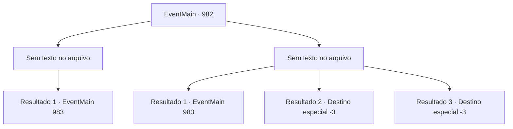

# Eventos principais · 982

[Índice da tabela](index.md) · [Índice geral](../index.md)

ID: `pt:EventMain:982` · Fonte: `EventMain4` · Versão: 1.2.47.

Mapeamento estático dos arquivos; a disponibilidade e a execução dependem do estado da run.

## Texto do evento

*Sem texto no arquivo.*

## Dados de entrada

```json
{
  "id": 982,
  "grade": 1,
  "normalGoal": "",
  "required": ""
}
```

## Mapa das escolhas



## Escolhas e resultados

### Escolha 1

*Sem texto no arquivo; o papel dessa opção depende da interface do jogo.*

Requisitos e outros campos da escolha:

```json
{
  "required": ""
}
```

#### Resultado 1.1

Você e Lodor estão lutando contra o monstro, esperando pelo sinal da equipe de extração. Mas então, em vez de um sinal, o grito de Lana pode ser ouvido. 

 "Algo deve ter dado errado!"

 Lodor exclama, esmagando a cabeça do monstro com sua maça. Você o segue para dentro do prédio. O interior do prédio parece órgãos de uma criatura, cobertos de carne roxa e difícil de navegar. Lá dentro você encontra Lana, Charlie e Naverr sendo atacados. 

 "Estamos aqui...! Pelo amor de Deus, NOS AJUDE!"


Continuação registrada: [Evento 983](0983.md) na mesma tabela.

```json
{
  "required": "",
  "chance": "1",
  "nextEvent": 983,
  "type": 2,
  "reward": ""
}
```

### Escolha 2

*Sem texto no arquivo; o papel dessa opção depende da interface do jogo.*

Requisitos e outros campos da escolha:

```json
{
  "required": ""
}
```

#### Resultado 2.1

As garras afiadas do monstro rasgam sua carne. Sangue quente molha o chão, acompanhado de uma dor lancinante. Ele se prepara para seu próximo ataque, que Lodor bloqueia com seu escudo. Mas então, em vez de um sinal, o grito de Lana pode ser ouvido. 

 "Algo deve ter dado errado!"

 Lodor exclama, esmagando a cabeça do monstro com sua maça. Você o segue para dentro do prédio. O interior do prédio se parece com os órgãos de uma criatura, cobertos de carne roxa e difícil de navegar. Lá dentro você encontra Lana, Charlie e Naverr sendo atacados. 

 "Estamos aqui...! Pelo amor de Deus, NOS AJUDE!"


Continuação registrada: [Evento 983](0983.md) na mesma tabela.

```json
{
  "required": "1_0_2|1_1_2",
  "chance": "1",
  "nextEvent": 983,
  "type": 2,
  "reward": "0_0_-1|0_1_-1"
}
```

#### Resultado 2.2

As garras afiadas do monstro rasgam sua carne. Sangue quente molha o chão, acompanhado por uma dor lancinante. Você desmaia, em cima da poça do seu próprio sangue.

Continuação registrada: [Destino especial `-3`](../destinos-especiais.md).

```json
{
  "required": "2_0_2",
  "chance": "1",
  "nextEvent": -3,
  "type": 2,
  "reward": "0_0_-1|0_1_-1"
}
```

#### Resultado 2.3

As garras afiadas do monstro rasgam sua carne. Sangue quente molha o chão, acompanhado por uma dor lancinante. Você desmaia, em cima da poça do seu próprio sangue.

Continuação registrada: [Destino especial `-3`](../destinos-especiais.md).

```json
{
  "required": "2_1_2",
  "chance": "1",
  "nextEvent": -3,
  "type": 2,
  "reward": "0_0_-1|0_1_-1"
}
```

## Referências que chegam a este evento

- [Evento 981 · escolha 1 · resultado 1](0981.md#escolha-1)
- [Evento 981 · escolha 2 · resultado 1](0981.md#escolha-2)
