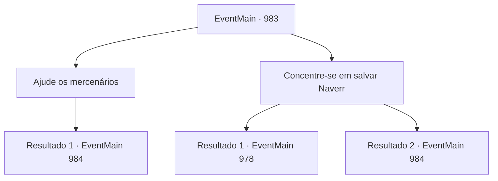

# Eventos principais · 983

[Índice da tabela](index.md) · [Índice geral](../index.md)

ID: `pt:EventMain:983` · Fonte: `EventMain4` · Versão: 1.2.47.

Mapeamento estático dos arquivos; a disponibilidade e a execução dependem do estado da run.

## Texto do evento

*Sem texto no arquivo.*

## Dados de entrada

```json
{
  "id": 983,
  "grade": 1,
  "normalGoal": "",
  "required": ""
}
```

## Mapa das escolhas



## Escolhas e resultados

### Escolha 1

Ajude os mercenários

Requisitos e outros campos da escolha:

```json
{
  "required": ""
}
```

#### Resultado 1.1

Você decide lidar com os monstros primeiro e depois resgatar Naverr. Gritando, os monstros avançam em sua direção.

Continuação registrada: [Evento 984](0984.md) na mesma tabela.

```json
{
  "required": "",
  "chance": "1",
  "nextEvent": 984,
  "type": 2,
  "reward": "6_4_169",
  "place": 15
}
```

### Escolha 2

Concentre-se em salvar Naverr

Requisitos e outros campos da escolha:

```json
{
  "required": "2_3_0"
}
```

#### Resultado 2.1

Você abre caminho para a luta, passando pelos mercenários e monstros. Você agarra Naverr e o tira rapidamente do prédio. Depois de correr por alguns minutos, vocês dois encontram um prédio abandonado para se esconder. Naverr respira ofegante e fala. 

 "*ofegante*... *ofegante*... Como você...?"

 Você tenta explicar, mas ele acena com a mão, dispensando o pensamento. 

 "Não, não. Deixe pra lá. O que importa é que você me tirou de lá - obrigado. Agora... a situação mudou, o que significa que nosso plano também deve mudar. Mas primeiro, pegue isso."

 Ele tira a Lente Ether e te dá. Dependendo do ângulo que você vê, a Lente Ether muda de cor. 

 "Cuide bem dela."

 Sua expressão então fica séria, enquanto ele começa a ponderar sobre algo.

Continuação registrada: [Evento 978](0978.md) na mesma tabela.

```json
{
  "required": "",
  "chance": "1|0_6_1",
  "nextEvent": 978,
  "type": 0,
  "reward": "5_693_1|0_3_-2|3_315_1"
}
```

#### Resultado 2.2

Você abre caminho para a luta, passando pelos mercenários e monstros. Você tenta agarrar Naverr. No entanto, os devoradores de almas te impedem e começam a atacar.

Continuação registrada: [Evento 984](0984.md) na mesma tabela.

```json
{
  "required": "",
  "chance": "25",
  "nextEvent": 984,
  "type": 1,
  "reward": "6_4_169",
  "place": 15
}
```

## Referências que chegam a este evento

- [Evento 982 · escolha 1 · resultado 1](0982.md#escolha-1)
- [Evento 982 · escolha 2 · resultado 1](0982.md#escolha-2)
