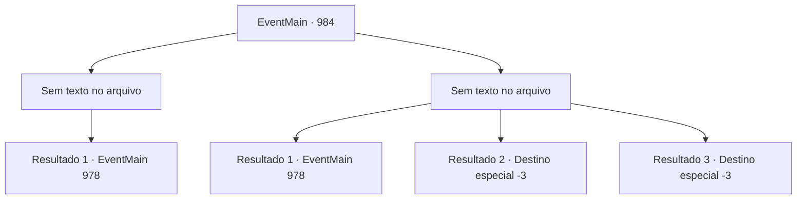

# Eventos principais · 984

[Índice da tabela](index.md) · [Índice geral](../index.md)

ID: `pt:EventMain:984` · Fonte: `EventMain4` · Versão: 1.2.47.

Mapeamento estático dos arquivos; a disponibilidade e a execução dependem do estado da run.

## Texto do evento

*Sem texto no arquivo.*

## Dados de entrada

```json
{
  "id": 984,
  "grade": 1,
  "normalGoal": "",
  "required": ""
}
```

## Mapa das escolhas



## Escolhas e resultados

### Escolha 1

*Sem texto no arquivo; o papel dessa opção depende da interface do jogo.*

Requisitos e outros campos da escolha:

```json
{
  "required": ""
}
```

#### Resultado 1.1

Você ajuda os mercenários, matando os monstros. Fluidos pegajosos e roxos cobrem a área. 

 "Ufa... pensei que íamos morrer. Caramba, não teria aceitado o trabalho se soubesse que seria tão perigoso..."

 Lana resmunga, enquanto Charlie suspira e fala. 

 "Teria sido muito mais fácil se você não tivesse gritado ao olhar para eles."

 Os dois começam a brigar, puxando o cabelo um do outro. Lodor dá de ombros e se vira para você. 

 "Bem, a boa notícia é que nosso trabalho está completo. Você é bastante capaz, sabia disso?"

 Naverr ofega e fala. 

 "*ofegante*... *ofegante*... Como você...?"

 Você tenta explicar, mas ele acena com a mão, dispensando o pensamento. 

 "Não, não. Deixe pra lá. O que importa é que você me tirou daqui - obrigado. Agora... a situação mudou, o que significa que nosso plano também deve mudar. Mas primeiro, pegue isso."

 Ele tira a Lente Ether e te dá. Dependendo do ângulo que você olha, a Lente Ether muda de cor. 

 "Cuide bem dela."

 Sua expressão então fica séria, enquanto ele começa a ponderar sobre algo.

Continuação registrada: [Evento 978](0978.md) na mesma tabela.

```json
{
  "required": "",
  "chance": "1",
  "nextEvent": 978,
  "type": 2,
  "reward": "3_315_1"
}
```

### Escolha 2

*Sem texto no arquivo; o papel dessa opção depende da interface do jogo.*

Requisitos e outros campos da escolha:

```json
{
  "required": ""
}
```

#### Resultado 2.1

Você ajuda os mercenários a lutarem contra os monstros. Mas seus ataques são mais fortes do que você pensava. A luta começa a dar errado. Mas então, alguém deve ter soltado uma fumaça - à medida que a área fica coberta pela fumaça preta, não é mais possível discernir quem está atacando quem. Você aproveita a oportunidade, encontrando Naverr em meio ao pânico, segurando suas mãos e fugindo. 

 Depois de correr por alguns minutos, vocês dois encontram um prédio abandonado para se esconder. Naverr respira ofegante e fala. 

 "*ofegante*... *ofegante*... Como você...?"

 Você tenta explicar, mas ele acena com a mão, dispensando o pensamento. 

 "Não, não. Deixe pra lá. O que importa é que você me tirou - obrigado. Agora... a situação mudou, o que significa que nosso plano também deve mudar. Mas primeiro, pegue isso."

 Ele tira a Lente Ether e te dá. Dependendo do ângulo que você vê, a Lente Ether muda de cor. 

 "Cuide bem dela."

 Sua expressão então fica séria, enquanto ele começa a ponderar sobre algo.

Continuação registrada: [Evento 978](0978.md) na mesma tabela.

```json
{
  "required": "1_0_2|1_1_2",
  "chance": "1",
  "nextEvent": 978,
  "type": 2,
  "reward": "5_693_1|3_315_1"
}
```

#### Resultado 2.2

As garras afiadas do monstro rasgam sua carne. Sangue quente molha o chão, acompanhado por uma dor lancinante. Você desmaia, em cima da poça do seu próprio sangue.

Continuação registrada: [Destino especial `-3`](../destinos-especiais.md).

```json
{
  "required": "2_0_2",
  "chance": "1",
  "nextEvent": -3,
  "type": 2,
  "reward": "0_0_-1|0_1_-1"
}
```

#### Resultado 2.3

As garras afiadas do monstro rasgam sua carne. Sangue quente molha o chão, acompanhado por uma dor lancinante. Você desmaia, em cima da poça do seu próprio sangue.

Continuação registrada: [Destino especial `-3`](../destinos-especiais.md).

```json
{
  "required": "2_1_2",
  "chance": "1",
  "nextEvent": -3,
  "type": 2,
  "reward": "0_0_-1|0_1_-1"
}
```

## Referências que chegam a este evento

- [Evento 983 · escolha 1 · resultado 1](0983.md#escolha-1)
- [Evento 983 · escolha 2 · resultado 2](0983.md#escolha-2)
